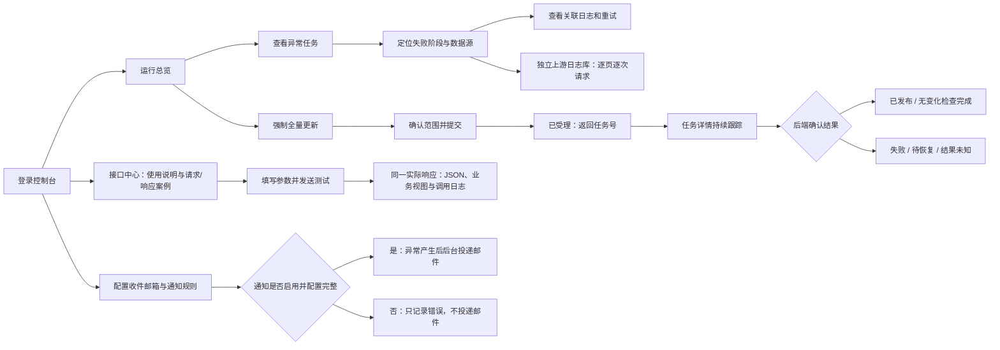
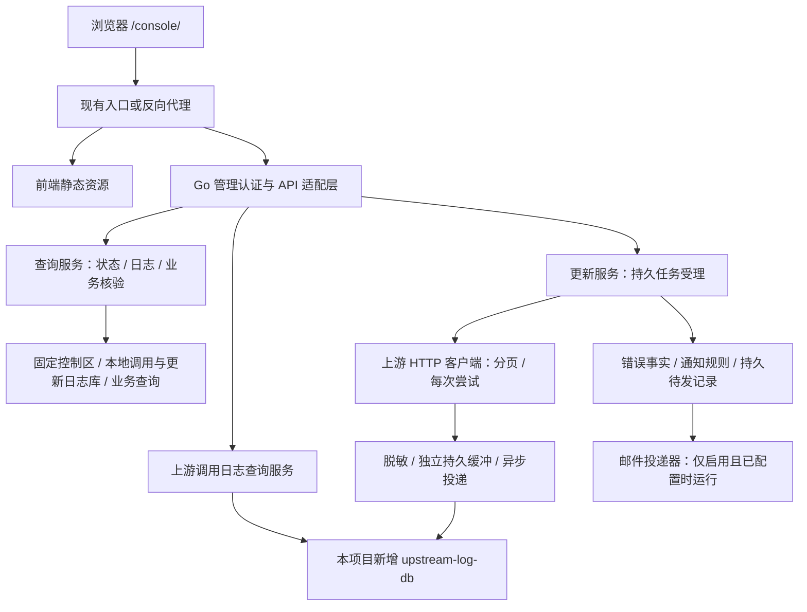

# SICP 本地数据中台前端设计方案

> 2026-10-12 开发安排调整：用户决定前端留待后续整体重构，当前分支暂不实现页面、组件、样式或交互。本文保留为后续需求输入；本分支按 [Phase 2 运维后端计划](PHASE2_OPERATIONS_DEVELOPMENT_PLAN.md)先交付后端及接入契约，本文中的前端工作和新增 UI 验收均不作为本分支后端交付前置条件。

> 2026-10-12 实施状态校正：九业务接口、管理员会话和九接口查询代理现已实现。本文下方“四接口已实现/其余五接口待开发”及 P05/P15 尚未完成等描述保留为设计编写时的历史背景，不作为当前开发清单。后续按 [Phase 2 日志与运维控制台开发计划](PHASE2_OPERATIONS_DEVELOPMENT_PLAN.md)推进；实际路由沿用 `/admin/v1`、`/console-api/session` 和 `/console-api/query`。首次初始化自动执行，立即增量复用已有入口；不按旧建议恢复手动初始化。现有 Vue/TS/Vite 和自有样式继续复用，完整 V5 产品范围保持不变。

> 编写日期：2026-09-22\
> 文档性质：供评审与后续开发使用的设计提案，包含低保真页面草图，不代表前端或新增接口已经实现。\
> 修订版本：V5（2026-10-10），接口中心与业务查询合并为“接口中心”，统一提供 Endpoint、参数、Response 说明和在线测试；业务结果展示归入同一测试弹窗。\
> 产品定位：管理员统一控制台，覆盖接口中心（文档、在线测试与业务数据核验）、以更新事件为核心的操作日志、原数据接口独立日志源、可选邮件通知以及运行管理。

## 1. 设计结论与项目依据

建议采用 **Vue 3 + TypeScript + Vite + Element Plus** 开发桌面优先的中文单页应用，部署在现有服务入口的 `/console/` 下。按完整功能设计并分阶段实施：运行总览、接口中心（含文档、逐接口在线测试与业务结果展示）、更新事件、日志中心、数据源、通知中心和系统设置均属于正式交付范围。认证与管理 API 复用 Go 服务体系，未实现接口仍展示说明与示例，并标明可测试状态。

页面围绕四个任务组织：**了解与测试接口、查看业务数据、追踪一次完整更新、发现并接收异常通知。** 主要内容采用接口目录与文档、上方填参下方展示结果的测试弹窗、数据表格、事件树和关联详情。

本次明确的产品要求：每个接口详情页提供接口信息、Query/Body 参数与 Response 案例，以及“在线测试”按钮；点击后打开当前接口的测试弹窗，上半部分填写参数，点击“测试”后下半部分显示实际返回结果。一次更新作为一个业务事件，下面展开各阶段、操作和调用尝试；原数据接口日志使用独立日志源接入；收件邮箱由管理员在前端配置，未配置时不启用邮件通知，其他功能正常运行。

**V5 已确认的信息架构：** 侧栏只保留“接口中心”，取消独立“业务查询”模块。选择接口后，在同一详情页查看 HTTP 方法与 Endpoint、所需参数、Response 结构与示例，再打开“在线测试”填写参数并查看实际结果。“业务查询”是在线测试在本地只读业务接口上的用途，界面统一使用“在线测试”，不提供两个执行入口。原查询的筛选、分页、表格、课表、组织树和行详情归入同一测试结果区，保留九接口全部展示能力。

**本轮交付范围（2026-10-10）：** 先统一整套设计图、离线评审图库与设计说明，实际前端实现另行开展。每个接口的说明均需覆盖 Endpoint、参数名与类型、必填条件、默认值/限制、请求示例，以及 Response 字段说明和成功/失败示例。在线测试在同一接口上下文内完成，结果视图保留原业务查询能力；全局导航和总览快捷入口同步合并。

### 1.1 已核对的项目现状

| 项目事实 | 依据 | 对前端的影响 |
| --- | --- | --- |
| Go 查询服务和更新服务分离 | `cmd/query-service`、`cmd/sync-worker` | 前端统一入口，后端负责服务间路由与权限 |
| 已有十四类源数据目录、控制区模型及存储迁移 | `internal/ingest/catalog.go`、`internal/storage/` | 可以据此定义数据源、任务、槽位和发布状态的展示模型；模型存在不等于 API 已可用 |
| 当前注册并实现接口 4—7：单人/批量成绩、学生/教师课表；其余五接口未注册 | `internal/query/contract/operations.go`、`internal/query/handlers/`、`development_docs/P01_PENDING_RULES.md` | 已实现接口按运行状态开放查询；未实现接口保留文档，不能把两者都标为业务占位 |
| `/livez` 表示进程存活；`/readyz` 动态检查处理器与依赖就绪状态 | `internal/service/http.go` | 未初始化或依赖不可用时显示未就绪；合法组合发布且依赖就绪后可查询，不能仅凭存活检查显示全绿 |
| 浏览器已有查询代理，转发四个业务接口及健康检查 | `internal/admin/query_proxy.go`、`frontend/src/api.ts` | 复用 `/console-api/query` 加业务路径，由服务端注入业务 key |
| 日志历史、详情、SSE 与强制全量按钮已有需求 | `PROJECT_ARCHITECTURE.md` 第 9.2、9.3 节 | 在此基础上扩展全量接口中心、事件操作树、双日志库和可选通知 |
| 当前阶段计划把日志/运维前端留在第二步 | `development_docs/PHASE1_DETAILED_DEVELOPMENT_PLAN.md` 第 1.1 节 | 本方案作为后续前端开发输入，开发进度与现有 P/T/I 编号区分 |
| 管理认证、日志持久化及管理接口仍有待完成项 | 阶段计划 P05、P15 | 前端可以先用合成数据开发，但真实联调依赖这些后端能力 |

### 1.2 文档与代码差异的处理规则

1. 旧架构文档存在 `GET /api/{stu,staff,score,sched,class}` 的设计；当前查询服务采用 `/api/v1/sicp/...` POST + JSON Body。业务字段以 `sicp-api-design.md` 为依据，接口 4—7 的鉴权、响应外壳、错误、参数边界与分页以 `P06_QUERY_CONTRACT.md` 为补充，源空值以业务文档 2026-10-09 补充说明为准。不同时建设两套客户端，也不因早期开发记录仍写“待定”而忽略后续已确认规则。
2. `sicp-api-design.md` 描述九个接口，当前代码已注册并实现其中 4、5、6、7；是否可用取决于运行依赖和合法发布组合。本方案完整覆盖九接口的目录、说明、示例和测试界面；其余五接口待后端实现、接入代理白名单并确认传输契约后启用真实测试，不直接套用四接口的全部运行约束。功能清单中的行政班查询与教学班查询语义不同，行政班条目保留为“契约待定”，不能用教学班接口替代。
3. 旧架构中的任务模式示意含 `forced_full`，当前控制表约束为 `force_full`。新增协议应统一使用后者，不让 UI 自行猜测模式映射。
4. 本文管理/测试 API 为完整控制台的目标建议；已有能力按 P15 与当前路由复用，新增部分在联调前固化契约。第 8.1 节查询代理已实现，不列为待建设接口，也不把数据表直接暴露成 API。
5. 四个已实现接口的响应外壳、错误码、成绩分页快照、文字成绩为 null、当前课程版本及未排课排除规则均已确认，详见第 4.6、4.7 节与 P06 契约。仍未定义的行政班接口、其余五接口的传输边界等单独列为待定，不由前端补造。
6. 本次需求覆盖旧文档“未知字段错误必须发邮件”的规定：错误事实和发布阻断继续保留，邮件成为可选能力。不配置收件人或关闭通知时，不发送、不为新错误创建邮件投递任务，也不因 SMTP 配置缺失阻止系统启动。
7. 用户已明确：原数据接口日志库由本项目新增，用于记录本项目发往上游接口的调用，不接入原平台内部日志库。新增 `upstream-log-db`，与记录本地 API 调用和更新操作的 `platform-log-db` 分开；需要独立连接、迁移、缓冲、查询与关联协议，见第 4.8 节。现有单库迁移不等于这些能力已实现。

## 2. 用户、范围与主要流程

### 2.1 用户与使用场景

默认场景：数据管理员在白天办公室的普通显示器上巡检，异常时需要在几分钟内判断影响范围并找到失败步骤。采用浅色、高可读性、中等密度界面。

| 使用者 | 主要任务 | 前端支持 |
| --- | --- | --- |
| 运维/数据管理员 | 巡检服务与数据状态，定位更新失败，执行授权操作并配置通知 | 完整控制台，按动作授权 |
| 排障人员 | 按请求号、任务号追踪调用与重试过程 | 只读状态、脱敏日志及关联跳转 |
| 经授权的业务核验人员 | 核对组织、人员、成绩、课表及教学班数据 | 接口中心的在线测试与业务结果视图，只读且由后端约束数据范围 |
| 接口集成人员 | 查看每个接口用法、复制示例、发起测试、定位失败 | 接口中心的文档与在线测试，查看文档与执行测试分别授权 |

上述是使用场景划分，不要求新增账号管理或角色配置平台。身份和动作权限由既有身份系统或独立管理认证提供。

### 2.2 交付范围

**完整交付范围：** 登录和动作授权、运行总览、接口中心（全量文档与示例、在线测试、业务结果展示）、十四类源状态、更新事件列表和操作树、业务调用日志、本地更新日志、原数据接口独立日志、邮件收件配置/规则/投递记录、初始化/同步/重跑等受控操作、运行配置状态和部署诊断。

实施可以分批，但分批不削减产品范围。未就绪接口显示“文档可查看、真实测试尚未就绪”；邮件未配置显示“通知未启用”，而不是功能缺陷。四接口之外的组织、人员、教学班功能必须计入完整验收。

不纳入任意 SQL、任意表编辑、通用用户角色平台和任意目标 HTTP 代理。管理操作经专用流程执行；恢复/回滚只有后端提供可验证的前置条件与权限时才可在页面提交，不提供裸数据库槽位切换。

### 2.3 完整功能覆盖矩阵

| 项目功能 | 控制台落点 | 主要操作与展示 |
| --- | --- | --- |
| A：服务、部署与交付 | 总览 / 系统状态 / 接口中心 | 双服务及依赖状态、版本、就绪原因、部署说明 |
| B：十四类源接入、令牌与调度 | 数据源 / 上游接口文档 / 更新事件 | 源字段、主键、凭据配置状态、调度/冷却、分页与重试；源令牌值不回显 |
| C：保存、校验、比较、双份构建与恢复 | 更新事件详情 / 组合与槽位详情 | 每步证据、两份导入、路由转移、发布、恢复与清理 |
| D：组织、人员、成绩、课表、班级等查询 | 接口中心（文档与逐接口测试弹窗） | 参数说明、Query/Body 和 Response 示例、真实响应与关联日志 |
| E：调用、更新、源调用及异常通知 | 日志中心 / 更新事件 / 通知中心 | 多日志源、事件层级、实时查看、收件人配置与投递结果 |

本表覆盖功能可见性和适合管理员执行的动作，不把部署自动化、数据库维护或负载压测变成浏览器任意执行脚本。

### 2.4 关键用户流程



“检查完成但无变化”适用于普通增量任务；强制全量即使内容相同也需要完成重建及发布，不能走无变化跳过分支。

## 3. 信息架构与导航

### 3.1 建议路由

| 导航 | 前端路径 | 核心内容 | 阶段 |
| --- | --- | --- | --- |
| 登录接入 | `/console/login` | 跳转身份系统、失败重试、返回目标页面 | 必须交付 |
| 运行总览 | `/console/overview` | 查询可用性、当前组合、更新与检查时间、异常任务 | 必须交付 |
| 接口中心 | `/console/apis`、`/console/apis/:apiId` | 全量接口目录、Endpoint、参数、Response 说明与示例 | 必须交付 |
| 在线测试弹窗 | 属于 `/console/apis/:apiId` 页面状态，无独立路由 | 点击当前接口的“在线测试”按钮，弹窗上方填参、下方查看结果 | 必须交付 |
| 更新事件 | `/console/updates` | 一次更新一行、触发来源、结果与操作入口 | 必须交付 |
| 更新事件详情 | `/console/updates/:updateEventId` | 事件→阶段→操作→调用尝试；两份构建与发布 | 必须交付 |
| 数据源状态 | `/console/sources` | 十四类源、成功进度、异常字段、关联任务 | 必须交付 |
| 日志中心 | `/console/logs/calls`、`/console/logs/updates`、`/console/logs/upstream`、`/console/logs/audit` | 接口调用、更新操作、原数据接口、管理审计 | 必须交付 |
| 日志详情 | `/console/logs/:sourceId/events/:eventId` | 带日志源命名空间的可分享详情 | 必须交付 |
| 通知中心 | `/console/notifications` | 异常事件与邮件投递记录 | 必须交付 |
| 邮件通知设置 | `/console/settings/notifications` | 收件人、开关、规则、测试邮件、通道状态 | 必须交付 |
| 系统状态与配置 | `/console/settings/system` | 版本、依赖、日志源、调度、凭据状态与部署说明 | 必须交付 |
| 无权限/页面不存在 | `/console/403`、兜底路由 | 明确说明与返回入口 | 必须交付 |

接口中心完整展示有权查看的接口目录，即使某接口尚未就绪也保留文档和示例，只禁用真实测试。无权限模块隐藏导航并拦截直接访问，后端再次验证权限。旧 `/console/sync/tasks/:taskId` 可作为跳转别名，统一导向对应更新事件。

侧栏顺序：运行总览、接口中心、更新事件、数据源、日志中心、通知中心、系统设置。原方案 `/console/query/:scene` 不再作为交付页面；如需兼容历史链接，仅按固定映射跳转对应接口详情，不自动发送请求。合并导航不扩大数据、测试或日志权限。

### 3.2 页面框架

- 顶栏高 56px：产品名、环境标识、当前授权范围、用户菜单。没有多学校能力时不展示学校切换器。
- 侧栏宽 216px，折叠后 64px；当前导航用浅底色、图标和文字强调。
- 主内容使用 24px 外边距，页面标题与主操作同一行；数据表可占满剩余宽度。
- 桌面 1440px 作为主要设计尺寸，同时保证 1280px 使用顺畅。
- 详情抽屉建议宽 560～720px，上限为视口宽度；长任务过程使用独立详情页。
- 页面顶部最多突出一个主要操作，低频操作放进文字按钮或更多菜单。

## 4. 核心页面设计

以下草图仅说明布局。`C100`、`T-DEMO-001` 等均为虚构展示值，不能作为真实运行状态。

### 4.1 运行总览

**目标：** 进入页面后优先判断查询是否可用、当前数据是什么版本、最近更新是否异常。

```text
┌ SICP 本地数据中台                    测试环境 · 当前范围 · 用户 ┐
│ 运行总览   │ 运行总览                          最后刷新 10:32  │
│ 同步任务   │ 查询可用 · 当前组合 C100 · 更新任务正在执行        │
│ 数据源状态 │ 内容发布时间 08:12   检查成功时间 10:05           │
│ 日志中心   │ 下次计划时间 12:00   源成功进度：查看 14 类       │
│            ├───────────────────────────────────────────────┤
│            │ 当前任务 T-DEMO-001         [查看任务]           │
│            │ 第二份构建中 · 已完成 9/14 类 · 开始于 10:00     │
│            ├───────────────────────────────────────────────┤
│            │ 需要关注：课程源字段校验失败     [查看关联日志]   │
│            ├───────────────────────────────────────────────┤
│            │ 数据源          状态      成功进度       关联任务│
│            │ 学生基础数据    已确认    2026-09-22 …   T-…    │
│            │ 课程数据        检查失败  保留上次进度   T-…    │
│            ├───────────────────────────────────────────────┤
│            │ 服务与存储详情 ▸                                 │
└────────────┴───────────────────────────────────────────────┘
```

设计规则：

- 使用紧凑摘要条承载关键状态，不以大数字统计卡片占据首屏。
- “查询可用”“同步状态”“日志查询可用”分别判断。同步失败但旧组合仍可服务时，显示“查询可用，最近更新失败”。
- 最近内容发布、最近检查成功、各源成功进度分别命名。无变化检查可以更新检查时间，不更新内容发布时间。
- 各源成功进度可能不同，默认提供逐源入口；如展示最早进度，明确标注“各源已确认进度的最小值”。
- 未获取到有效状态时显示“状态未知”或“状态读取失败”，保留上次快照并注明时间；不继续显示为当前正常。
- M/S、槽位、代次、组合编号收在“服务与存储详情”；当它们解释当前异常时才提升到主信息区。
- 首次未初始化显示“尚无可用数据”，说明需要通过受控初始化入口完成初始化。不能展示全量更新成功或伪造任务。
- 不根据最后更新时间自行推断数据已过期；过期阈值和判定由服务端状态提供，未配置则仅展示时间。

### 4.2 更新事件列表（执行任务作为底层事实）

页头提供“强制全量更新”，旁边固定说明：**重新同步全部 14 类数据，完成后统一生效。** 初始化、立即增量、失败重跑等动作按第 4.10 节进入对应流程。列表以更新事件号为主标识，同时可查看/复制关联任务号。

筛选项：时间范围、模式、结果、任务号。默认展示最近 24 小时，支持 7 天及受后端限制的自定义范围。筛选提交后请求服务端，不对当前页做伪全量筛选。

| 列 | 规则 |
| --- | --- |
| 任务号 | 短显示，支持复制和打开详情 |
| 模式 | 初始化 / 增量同步 / 强制全量 |
| 状态与阶段 | 分别显示“执行中”和“第二份构建”，避免把阶段名当终态 |
| 发起来源 | 定时或经认证的操作者；身份未知时如实展示 |
| 实际开始 / 结束 | 受理时间放详情；未知结束显示“尚未确认” |
| 耗时 | 完成值以服务端为准，执行中本地显示的估算注明“已运行” |
| 结果摘要 | 已发布、无变化、失败、待恢复，附候选/发布组合 |
| 操作 | 查看详情、查看日志 |

列表使用服务端分页。新任务到达时显示“有新任务，刷新列表”，不打断用户选中行或阅读位置。重复触发、任务互斥和发布未决由后端裁决。

### 4.3 更新事件详情

```text
任务 T-DEMO-001       增量同步 · 执行中                  [查看日志]
受理 10:00:00        实际开始 10:00:02        发布：尚未发生

阶段时间线
✓ 获取并封存  → ✓ 比较与候选校验 → ✓ 第一份构建
→ ✓ 查询转移 → ✓ 原实例排空 → ● 第二份构建 → ○ 双份验证与发布

数据源                窗口接收量   完整目标量   第一份导入   第二份导入
学生基础数据          …            …            …            …
课程数据              …            …            …            处理中

详情标签：[阶段与数据源] [转移与发布] [关联日志] [异常与通知]
```

时间线由后端步骤事实驱动。初始化、无变化、重启恢复的路径不同，允许步骤跳过并显示原因，不强制每个任务走完整同一路径。

- 任务级展示 `accepted_at`、`started_at`、`ready_at`、`published_at`、`checked_at`、`finished_at`，逐项给出中文含义；无事实则不填时间。
- 逐源展示窗口起止、已完成页数、接收条数、完整目标条数、变化条数、两份物理导入条数。来源不明确的计数显示“未知”。
- 只有总量可靠时展示百分比，否则用“已处理 18 页 / 9 类完成”和不定进度。禁止根据运行时长编造进度。
- 第一份/第二份对应实例从任务固定角色读取，不写死为 S/M；下一轮可能对调。
- “查询转移”与“内容发布”各有独立记录。查询转移到另一实例的旧组合，不表示新数据已生效。
- 两实例四槽位状态用紧凑矩阵展示：实例、槽位、代次、组合、是否接收查询、构建/备用状态；仅用于查看。
- 上游重试按逻辑调用展开各尝试，不用最终成功覆盖之前失败。
- 异常区展示错误事实及通知决策：通知未启用、规则未匹配、已抑制、待发送、发送失败或通道已接受。邮件开关不改变任务结果；详细配置与投递语义见第 4.9 节。
- 清理异常与发布结果分开显示，不能仅因清理失败就宣称已发布数据不可用；最终任务结果仍遵循后端定义。

### 4.4 数据源状态

使用一张十四行数据表，字段为：中文名称、源标识、主键、当前状态、最近检查、已确认进度、最近任务、异常摘要。

源目录来自后端，技术标识与 `internal/ingest/catalog.go` 对齐。中文名由受版本管理的映射提供；遇到新标识可回退技术名，不因显示名称缺失丢掉该源。

点击源行展开：当前窗口、最近一次失败、字段或类型异常、关联任务与日志入口。首版不展示原始人员记录，也不支持编辑映射、字段或主键。

“源成功进度”表示已确认处理的时间边界，不能解释为该时刻所有业务数据均无延迟；源数据晚到能力仍受现有重叠窗口约束。

### 4.5 日志中心

日志中心包含“接口调用 / 更新操作 / 原数据接口 / 管理审计”四个入口。历史与实时共用筛选器、表格及详情结构；每页固定对应日志源，页头明确显示“本地日志库”或“上游调用日志库”。更新操作页默认先定位更新事件，再展开阶段，详细模型见第 4.8 节。

```text
日志中心                        历史查看          [开启实时查看]
时间 最近1小时  类别 全部  结果 全部  任务号 …     [查询] [重置]
更多条件 ▾          已应用条件：任务 T-DEMO-001
──────────────────────────────────────────────────────────────
发生时间       服务/方向     操作/数据源     结果    耗时    详情
10:32:08.123    sync-worker   课程源第3页     超时    5000ms  查看
10:32:14.208    sync-worker   课程源第3页     成功     186ms  查看
──────────────────────────────────────────────────────────────
[加载更早记录]        当前显示 100 条，不代表日志总量
```

基础筛选为时间、类别、结果、任务号；高级筛选包含数据源、路径、方向、请求/调用号、HTTP 码、业务码、耗时范围、组合、槽位。默认最近 1 小时，默认每页 50 条，建议上限 200 条，最终边界由 API 返回或契约固化。

列表保留发生时间和入库时间的区别；晚到事件标“延迟入库”，不把入库时间冒充调用时间。每行对应明确的事件，开始和结束事件按调用关联；事件条数不作为请求次数。

详情抽屉按以下顺序展开：

1. 结果摘要、发生时间、入库时间、耗时、服务实例。
2. `request_id`、`task_id`、`step_id`、`call_id`、`attempt_id` 等关联标识；可复制并跳转筛选。
3. HTTP 结果与业务结果分别显示，包含发送前拒绝、结果未知等情况。
4. 脱敏请求条件、截断标记、脱敏错误与诊断内容。
5. 同一次调用的开始/结束、重试链和关联任务。

超长文本用折叠区；JSON 用等宽字体和语法层次，不通过 HTML 解释上游错误内容。复制的内容与页面显示采用相同脱敏结果，不提供“查看原始凭据”。

### 4.6 接口中心的业务参数与结果视图（完整范围）

本节定义第 4.7 节在线测试弹窗的业务表单与结果适配，不再建设独立查询工作台。采用“参数表单 → 执行 → 数据更新时间与实际结果 → 行详情”的统一结构，JSON、表格及适用的课表/组织树共用同一次响应。以下是目标交付范围；目前仅接口 4—7 已实现，其余场景保留文档及不可测试说明，不以 Mock 结果表示已接通。

| 接口/结果视图 | 请求条件（JSON Body） | 结果与分页 |
| --- | --- | --- |
| 学生成绩 | 必填 `student_number`；可选 `academic_year`、`semester` 及成绩公共筛选 | `total/synced_at/items`；每项为含 `student`、`course` 的 Grade；服务端分页 |
| 批量成绩 | 必填 `academic_year`（允许 `all`）；可选 `student_numbers`、`student_department_code/name`、`class_code/name` 及成绩公共筛选 | 与单人成绩共用 Grade，`total` 是成绩记录数，不是学生人数；服务端分页 |
| 学生课表 | 必填 `student_number/academic_year/semester`；可选 `course_query` | 回显学号、学年、学期，返回 `synced_at/items`；一次完整返回，无 `total`、无分页 |
| 教师课表 | 必填 `staff_number/academic_year/semester`；可选 `course_query`、`teaching_class_number` | 回显工号、学年、学期，返回 `synced_at/items`；一次完整返回，无 `total`、无分页 |
| 组织查询 | 可选单位号/名称、直属上级单位号、类别码数组、有效状态及分页；无必填筛选 | 组织树与表格，显示状态、层级和原编号；默认每页 1000，单页不能当作完整组织树 |
| 学生信息 | 可选学号、姓名、院系、校区、专业、年级、行政班、状态码及分页 | 基础信息、学籍、归属、授权联系方式；默认每页 1000 |
| 教职工信息 | 可选工号、姓名、单位、状态码及分页 | 基础信息、单位、授权联系方式；默认每页 1000 |
| 教师教学班 | 必填 `staff_number/academic_year/semester`；可选 `course_code`、`page/page_size` | 教学班课程组合、`teachers`、`student_count`；默认每页 100 |
| 教学班学生 | 必填 `teaching_class_number/planned_course_code/academic_year/semester`；可选 `page/page_size` | 去重学生名单、当前院系与行政班；默认每页 100，`total` 为学生数 |
| 行政班查询 | 当前契约待定 | 展示待定说明，与教学班明确区分 |

#### 4.6.1 成绩表单与结果规则

- 单人成绩仅学号必填。学年、学期均不传时，先取该学生最近有成绩的学期，再应用其余筛选；没有匹配结果不回退更早学期。指定学年、不传学期表示该学年全部学期；仅传学期时选有对应学期成绩的最近学年；`academic_year="all"` 才表示全部学年。页面必须显示当前范围含义，不能把留空统一标为“全部”。
- 批量成绩必须指定学年或 `all`，不传学期查所选学年的全部学期。学号列表、院系和行政班为可选筛选；不填筛选不等于拥有全校查询权限，授权范围由可信服务端限定。
- 成绩公共筛选包括 `semester`、`course_code`（精确）、`course_name`（包含）、`course_attribute_codes`、`course_nature_codes`、`course_type_codes`、`course_department_code/name`、`score_min/max`、`page/page_size`。高级筛选逐字段提供类型与空值说明；学生所属院系与课程开课单位分开命名。
- 多条件取交集，数组内取并集；可选条件不传或 null 表示未设置，不提交空字符串或空数组。成绩区间包含边界，下限不得大于上限，不自行限制为 0—100；有区间时只匹配数值成绩。
- `score=0` 显示 0，文字成绩的 `score` 已确认返回 null，不新增文字成绩字段，也不把 null 推断为缺考或零分。`grade_point`、`credits` 等可空数值分别处理；成绩学分取成绩记录，不用课程学分覆盖。
- 以 `grade_id` 标识成绩行，展示嵌套 `student` 与 `course`；同课程的不同成绩记录分别保留。课程信息取当前版本，学生院系/行政班取最新学籍，不展示为历史归属；课程表重修配置不能用来判定学生本次考试是否重修。
- 当前接口 4—7 使用严格 JSON 字段和类型校验：编号保持字符串及前导零；学年为相邻两年，仅成绩允许 `all`；学期为字符串 `1` 或 `2`。请求不超过 65536 字节、字符串不超过 512 UTF-8 字节、数组最多 1000 项。完整限制引用 P06，不能把同一限制未经确认推广到其余五接口。

#### 4.6.2 分页与数据时间

- 两个成绩接口 `page` 默认 1、上限 1000000，`page_size` 默认 100、上限 1000，均为正 JSON 整数。界面若选择 20 条，应显式发送 20，不能称为接口默认值。筛选后按学号、成绩 ID 升序分页，超末页 `items=[]` 但 `total` 不变。
- 首次成绩查询不带 `X-Query-Snapshot`，保存成功响应头中的快照凭据；翻页保持接口、所有有效条件和页大小不变，仅修改 `page` 并回传同名请求头。凭据不放业务 JSON，不替代鉴权。
- 更改条件、页大小或切换接口时清空快照，重新从第 1 页查询。快照默认 5 分钟有效（部署可配置 1—60 分钟），不续期；过期、绑定不符或原组合不可读返回 409。页面提示重新查询，不自动去掉凭据继续拼接结果。首次未返回凭据时禁用续页并说明原因。
- 师生课表没有服务端分页，不发送 `page/page_size` 或 `X-Query-Snapshot`。课表携带快照头返回 400；不能把课表的所有 409 都解释为快照过期，跨学期关系歧义也需要检查数据关系。
- 组织/人员、教学班/成员按各自业务文档分页；其传输层快照、页大小上限等在实现前确认，不假定已经支持成绩快照协议。
- `synced_at` 是该接口依赖数据集最近完整成功检查时间的最小值，空结果同口径；`source_updated_at` 是实际参与该条结果的源记录最大更新时间。两者与本次请求时间、内容发布时间分别展示，不用浏览器当前时间补值。

#### 4.6.3 课表与教学班联动

- 课表只返回实际排课记录，未排课课程不进入列表；已返回但缺日期或作息映射的排课仍保留列表。日期取 `dates`，周次取 `weeks`，不按起止周或学期起点推算日期。周视图按接口文档的 13 节作息逐节映射；表外正节次保留编号，不自行计算起止时间。
- 师生课表的 `course_query` 按完整课程号精确匹配或课程名称字面包含匹配；教师可再按教学班号精确筛选。所有条件取交集，不按行政班推测选课或授课关系。
- 展示 `teaching_class_name`、`enrolled_count`、`teacher_staff_numbers`、`room_code` 及日期、节次等字段，次要字段可放行详情。教师工号数组与姓名数组独立，不能按下标配对；不同教学班、日期、节次或地点的安排不按课程号合并。
- 按 2026-10-09 补充说明，教师排课缺计划课程号或教学班号时，对应编号可以为 `""`，课程名称/学分为 null；日期缺失为 `[]`，教师缺失为空数组。界面保留记录，标明缺失，不生成无效教学班跳转。学生课表关联仍需完整教学班号 + 计划课程号，缺可空计划课程号时不猜测关系。
- `enrolled_count=null` 不显示成 0，教室号保留前导零。源学年/学期缺失的记录不归入任一学期，前端不补分配。
- 教师教学班按学年、学期、教学班号、计划课程号共同标识。点击“查看学生”时进入教学班学生接口详情，并将这四项填入其测试表单，不自动提交；目标未实现或无权限时说明原因。课程筛选用 `course_code`，名单请求用 `planned_course_code`，不能混用字段名。
- 教学班 `student_count` 是关系表按学号去重的人数，与成员接口 `total` 同口径，不能用排课 `enrolled_count` 替代。成员按学号升序分页；组合不存在或跨学期复用无法区分成员时显示错误，不伪装为空名单，也不按行政班补齐名单。成员的行政班是最新学籍归属，不等于查询教学班。

#### 4.6.4 公共展示与权限

- 请求由管理会话鉴权的服务端代理转发，业务 API key 不进入浏览器构建产物、存储或表单。管理员核验输入的学号/工号仍须受服务端授权范围约束；学生自查工具的学号来自可信身份，不能把管理员核验表单直接复用为自查授权机制。
- 组织和人员不传筛选时包含停用状态；`is_active` 提供“全部/有效/停用”三态，不默认过滤停用组织。组织直属下级筛选不含更深层级，人员院系筛选不自动含下级单位；只有全部分页成功才能把组织树或名单视为完整。
- null 显示“未提供”，空数组显示“无记录”，未知代码保留原码。查询失败时保留输入；保留旧结果则明确标注“上次查询结果”，不能让旧数据看起来属于新条件；不把失败或部分结果当成成功空列表。
- 首版不做导出、均分趋势、人员画像和数据编辑。

### 4.7 接口中心：使用说明、示例与在线测试

接口中心是文档、在线测试与业务数据核验的统一一级导航，管理员不需要离开系统查 Markdown。采用左侧分组目录、右侧详情的结构，支持按名称、路径、功能和可测试状态搜索。

**三组目录：**

1. 本地业务接口：九个已设计接口，以及行政班等契约待定条目。
2. 上游源接口：十四类数据源的 GET 接口，说明参数、源字段、分页、限制和已知边界。
3. 管理接口：更新受理、状态、日志、通知配置等，说明其副作用；写操作从专用界面执行，目录提供对应入口。

#### 4.7.1 全量业务接口目录

下表路径统一以 `/api/v1/sicp` 为前缀，方法均为 POST，参数放入 JSON Body。接口 4—7 已实现，测试可用性按实际就绪与权限判断；接口 1—3、8—9 尚未注册，显示“未实现”，保留完整文档和示例。

| 编号 | 名称与路径后缀 | 应提供的 Query/Body 案例 | Response 案例与字段说明 |
| --- | --- | --- | --- |
| 1 | 组织 `/organizations/query` | 最小分页、单位定位、包含停用组织 | 组织层级、空结果、分页；来源：业务文档第 1 节 |
| 2 | 学生 `/students/query` | 按学号、单位/班级等已定义条件、分页 | 基础/学籍/归属/联系方式、关联名称为空；来源：第 2 节 |
| 3 | 教职工 `/staff/query` | 按工号、单位、分页 | 基础信息、所属单位、授权联系方式；来源：第 3 节 |
| 4 | 学生成绩 `/students/grades/query` | 仅学号查最近学期、`all` 跨学年、分类/开课单位/成绩区间、快照翻页 | 嵌套 student/course、零分/文字成绩 null、total 与空结果；来源：第 4 节、P06 |
| 5 | 批量成绩 `/students/grades/batch-query` | 必填学年或 `all`，学号/学生院系/行政班可选并取交集，快照翻页 | Grade 与单人一致，total 为成绩条数；来源：第 5 节、P06 |
| 6 | 学生课表 `/students/timetable/query` | 学号 + 学年 + 学期，`course_query` 筛选，不传分页 | 完整排课列表、日期/周次/节次、教师/地点、无课空数组；来源：第 6 节及空值补充 |
| 7 | 教师课表 `/staff/timetable/query` | 工号 + 学年 + 学期，`course_query` 与教学班号筛选，不传分页 | 完整排课列表、多教师独立数组、可空编号与日期；来源：第 7 节及空值补充 |
| 8 | 教师教学班 `/staff/teaching-classes/query` | 必填工号/学年/学期，可选 `course_code`、分页 | 四字段组合标识、teachers、student_count；来源：第 8 节 |
| 9 | 教学班学生 `/teaching-classes/students/query` | 必填教学班号/计划课程号/学年/学期，分页 | 去重学生名单、当前行政归属、total；来源：第 9 节 |
| 待定 | 行政班查询 | 参数、路径与返回粒度待确认 | 不复用教学班样例、不提供伪造成功响应 |

完整字段、嵌套对象和已有虚构示例以 [业务接口设计](../sicp-api-design.md) 为来源。上表描述要覆盖的用例，不新增未定义的筛选参数。九接口都应有最小有效请求与成功 Response；可分页接口另有分页案例。接口 4—7 使用 P06 的完整响应及失败案例；其余五接口的业务体示例与待确认传输协议分开标注。

十四类源接口按 [源接口索引](../latest_api_docs/README.md) 全量收录：教职工基础/通讯，学生基础/通讯/学籍，专业、年级专业、班级、课程、成绩、排课、课表、校区、院系所单位。每个接口均展示其独立参数表与 Response 字段，不使用一份通用表代替十四类字段。

#### 4.7.2 每个接口的文档模板

每个接口详情页在标题操作区提供 **“在线测试”按钮**，内容标签为 **概览 / 参数 / 请求案例 / 响应案例 / 调用记录**。在线测试始终绑定当前接口，通过弹窗完成，不另设导航项、内容标签或独立测试页面。

| 文档区域 | 必须展示 |
| --- | --- |
| 概览 | 用途、HTTP 方法、可复制的 Endpoint、环境、操作 ID、契约版本、实现状态、鉴权说明；方法与 Endpoint 常驻标题区，切换文档标签仍可见 |
| 参数 | 分开列 Path、Query、Headers、JSON Body；名称、类型、必填、默认值、范围、空值和组合规则 |
| 请求案例 | 最小查询、常见筛选、分页等命名案例；HTTP、JSON、curl 模板；“使用此案例测试”打开当前接口弹窗并填入参数 |
| 响应案例 | 完整成功结构、空结果、已确认失败结构；状态码、业务码、字段含义与可空性 |
| 使用限制 | 页大小、并发、权限范围、数据时间、一致性与尚未确定的规则 |
| 在线测试按钮与弹窗 | 按钮位于当前接口标题区；弹窗上方为当前接口参数表单，下方为同一实际响应的 JSON、业务视图、响应头及关联日志 |
| 调用记录 | 自动按 operation_id 筛选业务调用日志，可进一步定位本次测试 |

“Query”严格指 URL 查询参数：本地 POST 查询主要使用 JSON Body；上游 GET 使用 Query。页面不能把 POST Body 全部写进 URL。源接口的 `page=1`、`pageSize=15` 是文档示例，不因此标注为服务端默认值。

文档状态与运行状态分开：文档草案/已确认；接口未实现/未就绪/可用/暂停测试。具有测试权限时，未就绪接口也可打开弹窗编辑、校验和复制示例，但弹窗内“测试”按钮禁用并解释原因。无测试权限时详情页按钮显示不可用说明，后端仍独立校验权限。

#### 4.7.3 请求与响应示例样板

以下为界面示意，标识与内容均为虚构；不代表已执行请求。

**学生成绩，JSON Body 示例：**

```http
POST /api/v1/sicp/students/grades/query
Content-Type: application/json
X-API-Key: <由服务端安全注入，文档仅显示占位符>
```

```json
{
  "student_number": "S000001",
  "academic_year": "2025-2026",
  "semester": "2",
  "page": 1,
  "page_size": 20
}
```

**学生成绩空结果，HTTP 200 完整响应示例：**

```json
{
  "code": "ok",
  "message": "OK",
  "request_id": "0123456789abcdef0123456789abcdef",
  "data": {
    "total": 0,
    "synced_at": "2026-09-22T08:00:00+08:00",
    "items": []
  }
}
```

成功响应同时提供 `X-Request-ID`；成绩查询还提供 `X-Query-Snapshot`，在线测试可查看响应头并按第 4.6.2 节续页。完整非空响应将业务文档第 4 节的业务对象放在 `data` 中。课表的 `data` 则包含查询人编号、学年、学期、`synced_at/items`，没有 `total`，不能直接复用成绩结果 schema。

**服务未就绪时，HTTP 503 完整响应示例（不表示处理器仍是占位）：**

```json
{
  "code": "not_ready",
  "message": "Service not ready",
  "request_id": "0123456789abcdef0123456789abcdef",
  "data": null
}
```

接口 4—7 的 HTTP/业务错误已固定：400/invalid_argument、401/unauthenticated、403/forbidden、409/conflict、422/resource_exhausted、503/not_ready 或 dependency_failure、504/deadline_exceeded、500/internal。页面按当前操作解释错误，显示请求号；未知路径/方法的路由层 404/405 不保证业务外壳。查询代理连接失败可返回 502/unavailable，应与查询服务的业务错误区分。其余五接口尚未实现，不将上述示例标成它们已支持的实际响应。

不能把文档成功示例当成“发送测试”后的实际结果，也不能把传输测试夹具中用于覆盖空数组/null 的输入直接认作业务合法样例。

**上游成绩源，Query 示例：**

```http
GET <配置的上游基址>/openapi/invoke/sjzc/release/dwd_bzkscjzlb?page=1&pageSize=15&access_token=<服务端注入>
```

上游基址及 `/apizt` 前缀由服务端环境配置组合，不由浏览器任意输入。按源文档可确认的空列表 Response：

```json
{
  "code": 200,
  "message": "请求成功",
  "data": { "list": [], "total": 0 }
}
```

上游失败码及部分时间边界尚未完整确认，显示“待补充”；若开发 UI 需要失败夹具，必须标为合成测试场景，不充当提供方正式协议。

#### 4.7.4 逐接口在线测试弹窗与执行流程

**入口与绑定：** 管理员先进入某个接口详情页，阅读该接口信息，再点击页头“在线测试”。弹窗标题、方法、路径、参数定义、示例、目标和测试历史均绑定当前 `api_id`，弹窗内不提供接口切换器。关闭后回到原详情页的原阅读位置。

```text
接口中心 / 学生成绩查询                            [在线测试]
POST /api/v1/sicp/students/grades/query   [复制 Endpoint]
可用 · 契约版本
[概览] [参数] [请求案例] [响应案例] [调用记录]
当前接口的使用说明、参数表和请求/响应示例……

点击“在线测试”后：
┌ 在线测试 · 学生成绩查询                              [关闭 ×] ┐
│ POST /api/v1/sicp/students/grades/query                       │
│ 环境 [测试环境 ▾]          案例 [最小查询 ▾]                  │
│ 参数填写  [表单模式] [JSON 模式]                              │
│ 学号 *      [S000001            ]                            │
│ 学年        [2025-2026          ]                            │
│ 学期        [2 ▾]        页码 [1]    每页条数 [20]            │
│ 更多可选参数 ▾                           [重置参数] [测试]   │
├─────────────────────────────────────────────────────────────┤
│ 测试结果                                                    │
│ HTTP 200 · 业务成功 · 耗时 126ms · request_id: …             │
│ [JSON] [表格] [响应头]                       [复制结果]      │
│ { "code": "ok", "message": "OK", "request_id": "…",      │
│   "data": { "total": 0, "synced_at": "…", "items": [] } } │
│ [查看本次调用日志]         本接口近期测试 ▾                  │
└─────────────────────────────────────────────────────────────┘
```

草图结果为布局示意。弹窗首次打开时，下半部分显示“填写参数后点击测试，结果将在这里显示”，不自动发请求，也不预先放入成功案例充当真实结果。

**上半部分：参数填写。** 默认根据当前接口 schema 显示中文标签、参数名、类型、必填标记、帮助说明和校验错误；必填及常用字段优先，可选高级参数折叠。Query 与 Body 分组，JSON 模式用于复杂嵌套参数。已定义默认值可预填，案例值只在管理员选择案例时填入；鉴权由服务端注入并在界面说明，不要求用户填写 key。

**中间操作区：重置参数 / 测试。** 点击“测试”先校验当前参数；有错时定位到字段，不发请求。通过后固定本次参数快照并提交，按钮显示“测试中…”且禁止重复点击，结果区进入等待状态。执行中参数暂不可编辑，测试完成后可修改并再次测试。

**下半部分：实际结果。** 测试完成后在原弹窗内显示状态、耗时、结果体和日志关联，不跳转其他页面。请求成功但业务失败、HTTP 错误、网络/代理错误、超时、空数据和响应截断分别展示，失败时保留参数。再次测试时清空旧结果的当前展示并进入等待，避免把上次结果误认成本次；修改参数但尚未重测时，旧结果明确标记“上次测试结果”。

**同一结果的多种视图。** 默认显示完整 JSON 响应，并提供“表格”和“响应头”；课表接口增加“课表”，组织接口增加“组织树”。业务视图遵循第 4.6 节，包含数据时间、必要的分页与行详情。切换结果视图只改变呈现，不重新请求、不生成第二份测试记录；JSON 与业务视图对应同一请求及数据页。成绩翻页复用当前查询快照并更新所有视图；改变条件后重新测试才获取新快照。接口错误或无法识别的响应保留 JSON/响应头，不伪造空表格。测试弹窗支持“展开”至可用视口，仍为同一弹窗状态，不另建业务查询页面。

**尺寸与生命周期。** 桌面弹窗建议宽 960px，上限为视口宽度减 32px，高度不超过视口的 90%；上下布局固定，参数较多时内部滚动，JSON 内容区域提供有界滚动。小屏采用全屏弹窗，上方填参、下方结果的顺序保持不变。打开时焦点进入首个可填写字段，焦点留在弹窗内，关闭后返回页头按钮。点击遮罩不关闭，使用关闭按钮或 Escape；不为普通关闭增加确认流程。

关闭弹窗停止前端等待和轮询，不宣称取消已受理的后端请求。重新打开默认从未测试状态开始；如仍有该接口未确认结束的测试，通过测试号恢复其状态并暂禁重复提交。详情页切换接口时关闭弹窗并清理原接口参数/结果，不跨接口继承；异步回调校验接口 ID、弹窗实例和请求代次，旧响应不得写入新弹窗。本接口近期测试可在弹窗下方折叠查看，历史记录不替代当前测试结果。

- 请求案例与编辑内容双向独立：载入案例后允许编辑，标注“已修改”；表单/JSON 切换失败时指出字段或语法错误，不丢掉原文。
- 校验 schema、必填、枚举、范围与 JSON 格式，保留前导零；服务端执行同样的权威校验。未冻结的规则不得擅自宣称验证通过。
- 显示明确环境和授权数据范围，默认测试环境。生产只读测试需要相应权限和明显环境提示。
- 弹窗中的“测试”经受认证的服务端测试代理，按当前接口固定的 `api_id` 决定目标和允许参数。禁止任意 URL、任意 Header、重定向至未知目标或浏览器提交凭据覆盖服务器凭据。
- 对本地 API 测试必须经过实际业务路由的鉴权、校验和日志链路，不能直调仓储函数冒充端到端测试。业务 key 由服务端注入，操作者标识仅从可信会话传播。
- 上游测试只发明确页的一次查询，不自动拉取全部页，不更新同步成功进度、不写业务表、不触发发布；与同步共用上游调用限流和冷却预算，实际尝试落独立上游日志库。
- 更新、通知测试邮件等有副作用动作仍从专用确认界面执行，对应管理接口详情提供相应操作入口；本地业务查询与十四类上游查询均使用上述逐接口测试弹窗。
- 响应区分传输状态、目标 HTTP 状态、业务状态与测试代理自身错误。显示允许的响应头、request_id、时长、响应字节数和截断标记。
- 原始 JSON 面板展示经过授权与必要脱敏的实际业务体，保留结构、0、null、空数组；未授权内容不先下发到浏览器再隐藏。
- 超大响应有服务端字节限制和前端显示上限，截断结果明确标记，不能显示为完整成功校验。停止等待不等于证明目标没有处理请求。
- 历史持久保存操作者、接口、环境、契约版本、开始/结束、结果、脱敏参数摘要及日志关联；不默认持久保存完整人员响应。“再次填入”只恢复允许留存的参数，敏感值需重新填写。
- 测试代理审计记录与目标调用记录通过 `test_run_id` 关联，统计真实业务调用时不重复计数。目标未返回 request_id 时仍显示测试号并标注关联未确认。
- 文档契约建议整理为受版本管理的 OpenAPI/JSON Schema 与人工说明，驱动参数表、示例校验及测试表单；目前仓库没有完整 schema，该工作需纳入后端交付。

### 4.8 以更新事件为核心的详细日志与双日志库

#### 4.8.1 更新事件、执行任务和日志事件的区别

**更新事件**是一轮实际初始化/增量/强制全量的业务过程，使用 `update_event_id`；底层执行事实来自已有 `task_id`。默认一轮任务对应一个更新事件，可由服务端稳定映射，避免建立两套相互独立的状态机。**日志事件**是该过程中一条开始、结束或诊断记录，使用 `event_id`。

同一轮恢复继续关联原更新事件并新增恢复阶段；用户主动重跑创建新任务及新更新事件，通过 `predecessor_event_id` 链接原失败事件，不能覆盖历史。重复幂等提交返回同一个事件；调度到期但尚未实际创建任务的延期标记不伪装成已执行更新。

```text
更新事件 U-DEMO-001（对应任务 T-DEMO-001，增量同步，失败）
├─ 阶段：获取源数据
│  ├─ 操作：获取教职工基础数据
│  │  ├─ 逻辑调用：第 1 页 → 尝试 1 成功 [上游日志]
│  │  └─ 逻辑调用：第 2 页 → 尝试 1 超时 → 尝试 2 成功
│  └─ 操作：获取课程数据
│     └─ 逻辑调用：第 3 页 → 尝试 1/2/3 字段校验失败
├─ 阶段：封存与完整性校验 → 未执行（前置阶段失败）
├─ 阶段：比较与第一份构建 → 未执行
├─ 阶段：查询转移及排空 → 未执行
├─ 阶段：第二份构建与双份验证 → 未执行
├─ 阶段：正式发布 / 确认进度 → 未执行
├─ 操作：保留当前可用组合 → 已确认
└─ 异常通知 → 未启用 / 待发送 / 发送结果
```

正常流程还应展示完整基准合并、主键/字段/条数检查、内容比较、逐表写入与验证、路由转移、读者排空、第二份构建、双份业务就绪验证、正式发布、进度提交、旧槽位/暂存回收。源数据没有变化时展示实际完成的检查与复用路径，不补出不存在的写库步骤。

#### 4.8.2 事件详情的操作树

更新事件详情采用“左侧阶段/操作树，右侧所选操作详情”。顶部保留模式、操作者、时间窗口、原/候选/生效组合、总体结果、首个关键失败与通知状态。

每个操作节点至少包含：

| 分类 | 字段与行为 |
| --- | --- |
| 身份 | update_event_id、task_id、step_id、operation_id、parent_operation_id、trace/call/attempt 标识 |
| 目标 | 数据源、实例/槽位/代次、页码；不存在的目标留空 |
| 生命周期 | 受理/开始/结束、结果、耗时、跳过原因；无结束事件显示未知 |
| 数据量 | 读取/验证/写入/变化条数与字节数；窗口量和完整目标量分开 |
| 调用与证据 | HTTP/业务码、重试次数、预算/退避、摘要/规则版本、脱敏错误 |
| 关联 | 本地操作日志、上游每次请求、前后事件、告警/投递记录 |

树节点按服务端阶段顺序排列，并发操作保留真实重叠时段；展示“只看异常”“含重试”“全部步骤”。初次展开当前或失败阶段，其他节点按需加载，有分页，不一次加载整个更新的所有请求。

#### 4.8.3 两个日志库的职责

| 存储 | 本项目采集内容 | 前端入口 |
| --- | --- | --- |
| `platform-log-db`（现有独立日志库职责扩展） | 本地对外 API 调用、测试代理审计、更新阶段/操作、发布/恢复事实的日志副本、配置与通知操作审计 | 接口调用 / 更新操作 / 管理审计 |
| `upstream-log-db`（本项目新增） | 本项目 HTTP 客户端发往原数据平台的逐页逻辑调用、每次请求尝试、响应摘要、超时、限流、退避、解析/字段校验结果 | 原数据接口日志 |
| 固定控制区 | 权威任务、步骤、发布状态、通知配置/待发事实与必要关联索引 | 更新事件与通知状态的事实来源，不随日志库轮换 |

两个日志库分别配置数据库连接、账号、迁移、索引、连接池、存储预算、保留期和备份；需要进程故障隔离时部署为独立 PostgreSQL 实例。两条投递链路有各自持久缓冲、确认进度和积压监控，不共享无界队列。

更新服务和服务端上游测试代理使用同一上游调用采集边界，因此自动同步与人工源接口测试都进入 `upstream-log-db`。本地更新日志只引用上游调用号及摘要，不再重复保存完整逐次响应。

上游单次日志字段至少包含：日志源、event_id、任务/测试/更新事件关联、step_id、call_id、attempt_id、attempt_no、源标识、允许记录的路径/Query、页码/页大小、窗口、发送状态、HTTP/业务结果、响应条数/字节、耗时、错误类型、退避、发生/入库时间及截断信息。脱敏在进入内存缓冲和磁盘前完成，`access_token` 不得出现在 URL、客户端错误或日志详情中。

只记录本项目能观测到的事实：请求超时不证明原平台未处理，请求已发送不证明对方已接收；不显示原平台内部 SQL、内部异常栈等本项目拿不到的数据。

#### 4.8.4 跨库关联与查询

- `log_source` 固定枚举为 `platform` / `upstream`，记录主键及前端去重键为 `(log_source, event_id)`，避免两库 event_id 碰撞。
- 新采集链路统一生成/传播 `update_event_id`、`task_id`、`step_id`、`call_id`、`attempt_id`；人工测试无 task_id 时使用 `test_run_id`。不能凭相近时间自动认定两个事件属于同一调用。
- 页面经 Go API 按关联 ID 分别查询两库，事件详情保留“本地操作日志”“上游请求”分栏；不要求跨库 SQL JOIN 或两库同时提交的分布式事务。
- 一库写入延迟时显示“关联日志待入库”；一库不可用时只在该分栏显示故障及最近读取时间，另一库和控制区状态仍可查看。
- 更新事件总体结果由控制区事实决定，不能因某库少一条日志就推断任务失败或成功。
- 两个日志源使用各自分页/实时游标，不能互用。默认每个页面只订阅当前源；联合视图若实现，保留每源独立游标、连接状态与缺口提示，不生成未经证明的全局提交顺序。
- 保留期过后显示“相关日志已过保留期”；更新事件摘要保留策略与详细日志分别配置，不能把历史缺失展示为“从未执行”。

### 4.9 可选邮件通知：收件人配置、规则与投递

#### 4.9.1 页面与默认行为

新增“系统设置 → 邮件通知”。初始 `enabled=false`、收件人列表为空。**不配置邮箱可以正常使用全部接口、同步与日志功能；邮件功能不会自动开启。** 错误依旧写日志并在事件页显示。

```text
邮件通知                                      通道：未配置 / 可用 / 异常
邮件通知 [关闭 / 开启]
收件邮箱 [ops@example.invalid] [添加邮箱]
         支持多个收件人，保存后对后续告警生效
通知范围 [更新失败 ✓] [源接口持续失败 ✓] [服务异常 ✓]
         [字段/类型异常 ✓] [清理失败] [接口异常阈值]
合并窗口 [5 分钟]   同类提醒间隔 [30 分钟]
[保存设置]                              [发送测试邮件]
最近投递：时间 · 异常 · 收件人（授权可见）· 状态 · 失败原因
```

示例邮箱使用不可投递的文档域名。页面提供邮箱格式校验、重复提示、删除与多收件人编辑；不得为了校验格式自动发邮件。只有具有通知设置权限的管理员能编辑完整地址，普通排障页面只展示脱敏地址或人数。

邮件通道由服务端部署配置提供，例如 SMTP 地址、发件身份、认证及 TLS 设置。前端展示“通道已配置/未配置/异常”和安全摘要，不读取或回显密码；用户只需在页面维护收件人、开关和规则。邮箱设置不能替代发信通道配置，已填写邮箱但通道不可用时明确提示。

| 配置情况 | 保存、发送和系统行为 |
| --- | --- |
| 未配置收件人 | 有效状态保持关闭，不创建新邮件任务，系统正常运行 |
| 有收件人但开关关闭 | 保存地址供以后使用，不投递 |
| 有合法收件人、通道可用、开关开启 | 保存后生效，按规则发送后续异常 |
| 开启但收件人为空/无效 | 拒绝开启并标出字段错误；原有效配置不变 |
| 清空全部收件人并保存 | 明确提示“保存后关闭邮件通知”，原子保存关闭状态 |
| 通道未配置 | 允许保存关闭状态及草稿地址，拒绝开启/测试邮件；不阻塞查询或同步 |
| 已开启后通道故障 | 保留启用配置，显示“投递异常”，有界重试，不修改更新结果 |

配置持久保存在固定控制区，带 `revision`、作用范围、修改人和修改时间；更新使用版本检查，避免两个管理员互相覆盖。前端“保存成功”表示配置持久化完成，不表示邮件已发送。

#### 4.9.2 通知触发范围

规则按类别选择，采用建议默认值并允许管理员调整：

| 类别 | 建议触发点 | 合并与去噪 |
| --- | --- | --- |
| 更新失败/中断/发布待恢复 | 确认任务失败、恢复需要干预或未决超过配置阈值 | 同一更新事件合并关键错误和链接 |
| 上游不可用/令牌失效/限流 | 有限重试耗尽、持续故障达到阈值；测试请求按规则单独标记 | 不为每页每次重试分别发邮件 |
| 字段/类型/主键/完整性异常 | 验证失败且影响更新结果 | 相同源、错误指纹、规则版本合并 |
| 本地 API 服务异常 | 5xx、超时等在窗口内达到次数或比例阈值 | 不默认逐条通知普通参数错误和 401/403 |
| 数据库/日志投递/磁盘等运行异常 | 实际监测确认持续异常或积压超过阈值 | 有监测能力才允许开启该规则；非仅前端轮询 |
| 清理失败/恢复通知 | 管理员选择启用，且存在相应错误/恢复事实 | 与内容发布结果分别表达 |

规则评估在后端执行，浏览器关闭后继续有效。本地日志库或上游日志库中断的告警事实从投递器/监测器写入控制区，不能依赖故障日志库先可查询；控制区本身不可用时本系统不能保证通知，需要在状态中说明这一实际边界。

#### 4.9.3 邮件内容与生命周期

邮件主题建议：`[SICP][环境][严重级别] 更新失败 / 上游调用失败`。正文只包含时间、授权范围、接口/数据源、更新事件与失败阶段、错误摘要、重试次数、影响及控制台链接，不附人员原始记录、完整响应或凭据。链接指向需要登录的详情页，不携带令牌。

新增通知事实与投递记录使用独立 ID，关联 `update_event_id` / `request_id` / `call_id`、错误指纹和规则版本。持久待发记录位于固定控制区，不依赖两个日志库在线。

- 错误发生时按当时配置判断是否需要投递。关闭状态仅记录错误与“通知未启用”，不建立无限待发积压；以后开启默认不补发关闭期间的历史错误。
- 待发送、发送中、重试等待、通道已接受、失败终止、配置关闭已取消分别呈现。SMTP 接受不等于收件箱已送达；没有回执能力时不显示“已送达”。
- 每个收件人有独立状态与尝试记录，部分失败不把整封通知显示为全部成功。
- 使用错误指纹/事件与规则版本去重、合并窗口、提醒间隔、最大发送次数与总预算，避免故障风暴和永久重试；初始时间值是配置建议，需验收验证。
- 保存关闭或删除收件人后，未开始的对应投递取消并留下原因；每次重试再次检查开关和地址仍被授权。已经交给邮件通道的发送无法撤回，页面明确区分。
- 待发记录保留产生时的收件人快照与配置版本，新增收件人不自动收到旧事件；重试只发给快照与当前授权收件人的交集。
- 邮件发送失败本身进入投递记录与控制台提示，不递归为自身发送失败生成无限邮件告警。
- “发送测试邮件”是显式操作，使用保存后的地址和有权使用的通道，带测试标记、限流和审计；返回“已受理”后查看投递结果，不把保存设置视为授权发送测试。
- 外部邮件通道无法保证严格恰好一次投递；发生 SMTP 应答丢失时标注结果待确认，保留稳定消息标识和尝试记录，说明可能重复。

#### 4.9.4 与旧后端需求的变更清单

本次用户需求优先于 `function_list_V4.md` C-03/E-03、`PROJECT_ARCHITECTURE.md` 未知字段通知规则及 P05/P15 中依赖必配邮件的旧表述。后续实现须同步修订这些契约与验收：

1. 未知字段仍按规则停止发布、不推进成功窗口；邮件发送条件改为已开启且已配置收件人及通道。
2. 未启用时无需 SMTP 配置，不以缺少邮箱阻止服务启动或使业务就绪检查失败。
3. 增加收件人/规则持久配置、权限、审计、部分投递、开关变更与取消语义。
4. 原有通知 outbox 可演进复用，但需新的配置表、逐收件人投递表及迁移，不能仅靠前端隐藏开关完成。

此次只修订前端设计方案，不代表上述后端需求文件、数据库结构和实现已经改变。

### 4.10 运行管理与配置状态

完整控制台应提供初始化、立即增量同步、强制全量、失败重跑的授权入口，并展示当前调度、共享冷却、延期标记、源凭据配置版本、两个日志库状态、缓存与存储状态、发布未决和清理结果。

每个动作由后端返回 `allowed_actions` 与不可执行原因，前端不得仅根据颜色或状态名推断许可。重跑创建新事件并链接原事件；首次初始化与已有组合的全量更新使用不同说明。恢复/回滚界面先读取服务端评估的目标、证据与影响，满足前置条件才显示确认提交；条件变更后后端再次检查。

源令牌和底层连接配置先沿用服务端受控维护，前端查看配置状态、版本及操作说明。若后续增加令牌更新表单，仅允许一次性输入和服务端安全保存，不回显历史值；不擅自承诺上游自动续期。

## 5. 关键交互与状态协议

### 5.1 强制全量更新

这是有副作用的低频操作，使用一次明确的确认对话框：

> **强制全量更新**\
> 将重新获取并重建当前授权范围内的全部 14 类数据，两份验证通过后统一生效。已受理任务在关闭页面后继续执行。\
> 当前范围：由服务端认证上下文提供。\
> 按钮：返回 / 确认强制全量更新。

处理顺序：

1. 页面根据能力和当前状态决定入口是否可用，禁用时显示“已有任务执行中”“发布状态待确认”或“尚未初始化”等具体原因。
2. 用户确认时创建本次操作的幂等标识，提交期间禁止重复点击。
3. 后端持久受理后返回 202 与任务号。页面显示“任务已受理”，跳转任务详情，不显示“更新成功”。
4. 发生超时或应答丢失时显示“受理结果待确认”，使用同一幂等标识查回任务；不得自动生成新标识再次提交。
5. 幂等标识可短期保存在当前会话的 `sessionStorage`，绑定环境与操作范围，供刷新后查回；退出时清理，存储本身不作为权限依据。
6. 后端忙碌时返回明确冲突及当前任务号，页面引导查看该任务，不增加浏览器排队机制。
7. 仅在后端确认发布完成后显示“新数据已生效”。连接中断、页面关闭和超时均不代表后台任务取消。

### 5.2 SSE 实时日志

SSE 用于服务器到浏览器的日志事件流，连接、事件 `id` 与重连行为遵循浏览器协议；应用级完整性仍需要后端的持久游标保证。参见 [MDN SSE 文档](https://developer.mozilla.org/en-US/docs/Web/API/Server-sent_events/Using_server-sent_events)。

必须固定以下协议：

- 首次历史响应同时给出 `items`、历史分页 `next_cursor` 和实时衔接 `stream_cursor`。后两者不同用途，不混用。
- 实时相对时间范围在开启时固定下界，上界为持续流；不得继承历史请求的固定结束时间而停止收到新事件。服务端签发的游标须明确绑定这套筛选语义。
- 从服务端给出的衔接位置开启订阅，补齐“历史加载完成到连接建立”之间的事件。不能用浏览器时间替代游标。
- 实时游标不以事件发生时间或普通自增 ID 推断提交顺序。后端应保证跨实例、晚到补投及并发晚提交不会被跳过。
- 重复事件按 `(log_source, event_id)` 去重；独立开始/结束事件保留各自 ID，不按任务号粗暴去重。游标绑定日志源、授权范围和筛选条件。
- 切换筛选条件时取消旧请求并关闭旧连接，用请求代次隔离迟到结果；新条件重新获取历史与游标。
- 关闭实时查看或离开页面释放连接。网络中断显示“正在重连”，有限退避后提供手动重连。
- 权限失效立即关闭连接、清除敏感内容并要求重新登录；游标过期明确显示“历史衔接位置已过期，请重新加载”，不静默跳过缺口。
- 流量突增时采用有界缓冲和列表虚拟化，建议最多保留 1,000 条可见摘要；超过容量记录裁剪提示，旧记录可按历史接口补查。该数字是初始预算，需实测调整。
- 用户滚动阅读旧记录时暂停视觉插入，显示“收到 N 条新日志”；点击后再更新。暂停滚动不等于停止接收，内存仍需受上限约束。
- 日志库不可用显示“日志查询暂不可用”，不能显示“暂无日志”。降级轮询也必须沿用持久游标和权限约束。

建议同源 Cookie 会话下使用原生 EventSource；明确处理登录失效与游标过期的服务端控制事件，并通过受认证状态接口核实无法辨认的断连。若最终身份方案必须使用自定义授权头，再采用可取消的流式 fetch 客户端，不把访问令牌放进 URL。

### 5.3 通用状态文案

| 情况 | 页面行为 |
| --- | --- |
| 首次加载 | 保持表格与标题布局，用骨架占位；操作不可重复提交 |
| 成功且为空 | “当前条件下没有记录”，提供调整条件，不提示系统故障 |
| 尚未查询 | “填写查询条件后查看结果”，与空结果区分 |
| 服务未就绪 | “服务尚未就绪，暂不能查询”，显示重试及可用诊断入口 |
| 网络或依赖失败 | 保留条件，展示重试与请求号；不输出原始堆栈 |
| 状态刷新失败 | 保留旧快照并醒目标注“数据截至…，刷新失败” |
| 无权限 | 明确说明当前动作不可用，不展示受限数据 |
| 任务仅有开始事件 | “结果尚未确认”，结束时间留空 |
| 实时连接中断 | 独立连接状态条，历史数据仍可阅读 |
| 不识别的新状态 | 显示“未知状态（原值）”，不默认归类成功 |

全站时间默认 Asia/Shanghai，日期时间显示到秒，日志可到毫秒，并标明时区。源业务时间保留其原有语义；不根据没有时区的字符串擅自转换。运行耗时最终采用后端值。

## 6. 视觉规范

### 6.1 视觉方向

采用甲方 AI Hub 的浅色主题，以 [Hub 主题色清单](ui-review-v1/hub-theme-colors.md) 为配色依据：宝蓝主色 #195BFF、冷灰背景 #F7F8FA、白色面板与深色文字。管理端一级侧栏选中项使用白底卡片与蓝色左侧指示条，二级选中项使用浅蓝底和深蓝文字。色彩面积控制在约 10% 以内；成功、警告、失败用各自语义色、文字和图标共同表达。

参考锚点仅用于沟通设计方向：Element Plus 的标准表单与表格、VS Code 的列表/详情分区、GitHub Actions 的任务步骤阅读方式。沿用可辨认的操作习惯，不复制整页样式。组件视觉原则参考 [Element Plus 设计指南](https://element-plus.org/en-US/guide/design.html)。

本文保留低保真布局和样式规范，并于 2026-10-10 同步 [全套 UI 图片评审 V5（28 张）](ui-review-v1/index.html)。全局侧栏统一为七项，接口中心集中展示 Endpoint、参数与 Response 示例，在线测试通过当前接口弹窗完成；06—14 展示其业务结果视图，27 展示移动端全屏测试层。登录页与已有合并稿经复核沿用，其余受影响图片已用内置 image_gen 修订。完整交付包为 [SICP-UI-review-v5.zip](SICP-UI-review-v5.zip)，包含图片、可离线评审图库与本设计方案；V1 压缩包仅保留为历史归档。可在图库逐张放大、记录意见并导出评审结果。图片均为设计预览与合成示例，细小文字与精确字段以正式接口契约为准；本轮未修改实际前端代码。

### 6.2 设计令牌（甲方 Hub 主题）

```css
:root {
  --color-app-bg: #F7F8FA;
  --color-panel: #FFFFFF;
  --color-surface-muted: #F3F5F8;
  --color-text-strong: #111827;
  --color-text: #1A1C19;
  --color-text-muted: #667085;
  --color-text-subtle: #9AA3AF;
  --color-primary: #195BFF;
  --color-primary-hover: #0F48D8;
  --color-primary-soft: rgb(25 91 255 / 14%);
  --color-focus: #2563EB;
  --color-success: #16823C;
  --color-danger: #D92D20;
  --color-danger-hover: #B42318;
  --color-control-border: #CFD6E2;
  --color-panel-border: #D9DEE8;
  --color-divider: #E3E7EF;
  --color-sidebar-bg: #F6F7F9;
  --color-sidebar-text: #344054;
  --color-sidebar-active-bg: #FFFFFF;
  --color-sidebar-accent: #2563EB;
  --color-sidebar-active-structural: #E2ECFF;
  --color-sidebar-active-structural-text: #1D4ED8;
  --radius-control: 6px;
  --radius-panel: 8px;
  --space-1: 4px;
  --space-2: 8px;
  --space-3: 12px;
  --space-4: 16px;
  --space-6: 24px;
  --space-8: 32px;
}
```

主按钮、链接、当前步骤和交互选中态统一使用品牌蓝；成功、错误与禁用状态保留语义色和文字。警告仍使用独立的琥珀色提示，Hub 清单未定义警告令牌，实施时需单独确认，不能将警告色作为品牌主色。完整悬停、边框及阴影规则见 Hub 主题色清单。

生成图片用于视觉评审，精确色值以令牌为准。配色变化后需重新验收实际组件的文字对比度、焦点、控件边界、遮罩与禁用态；旧赭色方案的对比度计算不再适用。

### 6.3 字体、间距与组件

- 字体使用 `system-ui, "PingFang SC", "Microsoft YaHei", sans-serif`，离线部署不依赖外部字体 CDN。
- 页面标题 24px/600，区块标题 18px/600，正文和表格 14px，辅助信息 12px。辅助字号不承载唯一的关键状态。
- 正文行高约 1.5；任务号、源标识、JSON 用等宽字体；数值列右对齐并使用等宽数字。
- 表格默认行高约 44px，可提供 36px 紧凑模式；表头固定，超宽内容仅在表格内部滚动。
- 按钮和输入框默认高 36px，工具栏间隔 8px；主要表单标签置于上方或采用统一左侧宽度。
- 按钮文案使用“查询日志”“查看任务”“确认强制全量更新”等明确动作，不使用含糊的“确定”。
- 只在悬浮抽屉/弹层使用轻阴影，普通区块用留白和分隔线划分；不叠加大面积阴影、渐变、玻璃效果或多层卡片。
- 状态统一为图标 + 文本，颜色仅辅助识别；链接始终有可辨认的交互样式。
- 下拉框、日期面板与抽屉通过 portal/Teleport 等机制脱离表格裁剪容器；统一弹层层级，不任意使用 9999。

建议复用组件：`AppShell`、`PageHeader`、`FilterBar`、`StatusBadge`、`Timestamp`、`CopyId`、`CursorTable`、`TaskTimeline`、`SourceProgressTable`、`LogDetailPanel`、`ConnectionStatus`、`AsyncActionDialog`，以及接口中心的 `ApiCatalog`、`ParameterTable`、`ExampleViewer`、`ApiTestDialog`（内部上方为 `RequestEditor`，下方为 `ResponseViewer`），更新日志的 `UpdateOperationTree` 和通知的 `RecipientEditor`、`DeliveryStatus`。

## 7. 前端工程方案

### 7.1 技术选择

| 技术 | 用途与选择理由 |
| --- | --- |
| Vue 3 + TypeScript | 以单文件组件组织页面和交互，类型约束查询条件与响应适配；参见 [Vue 官方文档](https://vuejs.org/guide/introduction.html) |
| Vite | 本地开发和静态资源构建，构建后无须额外 Node 服务；参见 [Vite 官方指南](https://vite.dev/guide/) |
| Element Plus | 复用表格、表单、日期筛选、抽屉和对话框，统一覆盖主题令牌 |
| Vue Router | 管理 `/console/` 路由、访问守卫和详情深链接 |
| 原生 fetch + 小型类型化 API 层 | 统一取消请求、超时、错误解析、请求号和 Cookie 会话；不为只读列表引入复杂全局状态 |
| EventSource | 同源会话下的实时日志连接；根据最终认证协议再决定是否改为流式 fetch |
| Vitest + Vue Test Utils / Playwright | 分别验证状态逻辑与关键浏览器流程，测试工具在实施时锁定兼容版本 |

具体依赖版本在项目初始化时验证后写入 lockfile，CI 使用同一 Node 与包管理器版本。本文不指定尚未验证的版本组合。

首版不要求 SSR、微前端、可视化图表库或新的 Node 后端。运行态数据放页面 composable，只有会话、能力、时区和密度需要应用级共享；复杂度增加后再考虑集中状态库。

### 7.2 建议目录

```text
web/                              # 后续新增，本文不会创建该工程
  src/
    app/                          # 启动、路由、会话、能力
    layouts/                      # 控制台框架
    pages/
      overview/
      sync/
      sources/
      logs/
      apis/                       # 统一接口中心：文档、案例、在线测试与业务结果
      updates/                    # 更新事件及操作树
      notifications/              # 告警与投递记录
      settings/                   # 收件人、规则、运行状态
    components/                   # 跨页面通用组件
    features/
      sync/                       # 全量受理与任务展示
      logs/                       # 游标、去重、实时缓冲
      api-testing/                # schema、测试执行、结果适配
      notifications/              # 配置版本、收件人和投递状态
    api/                          # 客户端、DTO、错误适配
    composables/                  # 请求生命周期、轮询等
    styles/                       # 令牌与组件库主题覆盖
    mocks/                        # 仅开发/测试的合成数据
    tests/
  e2e/
  package.json
  vite.config.ts
```

路由按页面懒加载。请求状态采用明确的 idle/loading/success/empty/error，任务受理状态单独建模。切换条件用 AbortController 取消旧请求，并校验请求代次，防止旧结果覆盖新筛选。

敏感业务条件、查询结果、授权凭据不写入 URL 或持久缓存。可分享的 URL 仅保存非敏感日志条件和 opaque 标识，服务端仍校验范围；人员学号、姓名、联系方式默认只保留于当前页面内存。

### 7.3 同源部署与认证



- 前端静态资源由既有反向代理承载；也可后续采用 Go 静态文件服务，但必须正确区分 SPA 路由回退与 API 错误。
- 使用 HttpOnly、Secure 的管理会话 Cookie，配置适合最终身份接入流程的 SameSite 策略；变更请求同时校验 CSRF 与 Origin。
- 管理权限与业务 API key 分离；请求发起人、学校/源范围由可信会话给出，不能接受浏览器自报身份作为认证事实。
- 管理 API 的读权限、同步操作权限、业务数据核验权限分别判定。前端能力仅用于显示，服务端必须再次授权。
- 浏览器访问同源受认证适配层，不直接访问数据库、Redis、上游平台或 worker 的未保护入口。
- SSE 转发关闭代理缓冲，设置合适心跳与空闲超时；API 和流式错误不能被入口改写成登录 HTML 或 SPA 页面。
- 退出登录关闭实时连接、清除页面敏感状态、失效会话；静态构建产物中不包含 API key、上游令牌、数据库连接串。
- 生产构建不启用 Mock，不依赖外网 CDN。静态资源使用内容指纹，HTML 采用可更新缓存策略，API 响应不走静态缓存。

## 8. 前后端接口对照与待补能力

### 8.1 当前已注册接口

| 方法与路径 | 当前状态 | 对应前端 |
| --- | --- | --- |
| `GET /livez` | 已有存活检查 | 只作为服务探测依据之一 |
| `GET /readyz` | 动态检查依赖与处理器就绪，按事实返回 200 或 503 | 不直接当作完整运行总览 |
| `POST /api/v1/sicp/students/grades/query` | 处理器与真实服务装配已实现，运行可用性以就绪检查为准 | 学生成绩 |
| `POST /api/v1/sicp/students/grades/batch-query` | 处理器与真实服务装配已实现，运行可用性以就绪检查为准 | 批量成绩 |
| `POST /api/v1/sicp/students/timetable/query` | 处理器与真实服务装配已实现，运行可用性以就绪检查为准 | 学生课表 |
| `POST /api/v1/sicp/staff/timetable/query` | 处理器与真实服务装配已实现，运行可用性以就绪检查为准 | 教师课表 |

浏览器通过现有 `POST /console-api/query/api/v1/sicp/...` 调用上述四个业务路径，例如 `/console-api/query/api/v1/sicp/students/grades/query`。健康检查走 `GET /console-api/query/livez` 与 `/console-api/query/readyz`。代理只转发白名单路径，拒绝 URL Query，由服务端注入业务 key；浏览器使用管理会话与 CSRF 防护，不能获取共享 key。

代理保留 `Content-Type`、`X-Request-ID`、`X-Query-Snapshot`、`Retry-After` 响应头，并转发成绩快照请求头；前端从 `data` 读取业务结果、从 `code` 判断业务成功。后续扩展另外五接口需同时完成处理器、传输契约和代理白名单，不另建 `/admin/api/query/{operation}` 查询入口。在线测试执行/历史接口仍属于第 8.2 节的新增能力。统一执行器按能力选择已交付的执行链路：现阶段本地四接口复用现有查询代理；后续测试执行服务接入时复用现有白名单、凭据注入及业务路由链路，不另建业务查询后端。一次点击只走一条链路，不能同时请求两个代理；不得虚构尚未具备的测试历史或测试号。

### 8.2 建议新增管理协议

**下表是完整控制台的目标管理/测试协议，不作为当前接口实现清单。** 新增能力使用建议的 `/admin/api` 路径，已有管理能力应先对照 `P15_MANAGEMENT_API.md` 与当前路由复用、补齐；本地业务调用复用第 8.1 节已有 `/console-api/query` 代理能力。需要 worker 执行的操作由服务端处理，不要求浏览器直连内部受理入口。

| 方法与建议路径 | 最低响应/请求内容 | 页面依赖 |
| --- | --- | --- |
| `GET /admin/api/session` | 认证用户、授权范围、动作能力、已启用功能 | 登录与导航 |
| `POST /admin/api/session/logout` | 失效会话 | 退出登录 |
| `GET /admin/api/overview` | 查询/同步/日志可用性、当前组合、各类时间、活动任务、服务端时间 | 总览 |
| `GET /admin/api/sources` | 源目录、主键、进度、状态、关联任务、脱敏异常 | 数据源 |
| `GET /admin/api/sync/tasks` | 有限时间范围、筛选、items、next_cursor | 任务列表 |
| `GET /admin/api/sync/tasks/{task_id}` | 任务事实、步骤、逐源计数、两份构建、发布/通知事实 | 任务详情 |
| `POST /admin/api/sync/force-full` | 幂等请求标识；202 返回 task_id/update_event_id，忙碌返回现有任务与事件 | 强制全量 |
| `GET /admin/api/sync/requests/{request_key}` | 按幂等标识查受理事实，再次验证操作者/范围 | 应答丢失恢复 |
| `GET /admin/api/logs/{source_id}/events` | 有界筛选、items、next_cursor、stream_cursor、截断/保留信息 | 双日志库历史及实时衔接 |
| `GET /admin/api/logs/{source_id}/stream` | 已提交事件、opaque 续传游标、心跳、失效控制事件 | 实时日志 |
| `GET /admin/api/logs/{source_id}/events/{event_id}` | 脱敏详情、关联标识、截断信息 | 日志详情 |
| `GET /admin/api/apis`、`GET /admin/api/apis/{api_id}` | 全量目录、契约版本、参数/响应 schema、命名示例、实现/测试状态 | 接口中心 |
| `POST /admin/api/api-tests` | api_id、环境 ID、契约版本、允许的 Query/Body；返回 test_run_id | 服务端在线测试代理 |
| `GET /admin/api/api-tests`、`GET /admin/api/api-tests/{test_run_id}` | 脱敏测试摘要、目标/代理结果、日志关联；结果按权限及保留期获取 | 测试历史与结果 |
| `GET /admin/api/update-events`、`GET /admin/api/update-events/{id}` | 事件与 task_id 映射、来源、模式、结果、关联前次事件 | 更新事件列表/摘要 |
| `GET /admin/api/update-events/{id}/operations` | parent_operation_id、分页、阶段顺序、状态/计数及日志关联 | 懒加载操作树 |
| `POST /admin/api/sync/initialize`、`POST /admin/api/sync/incremental` | 幂等标识、经认证范围；202 返回任务与更新事件号 | 初始化/立即增量 |
| `POST /admin/api/update-events/{id}/rerun` | 创建新任务/事件、链接前次事件，互斥与前置检查 | 失败重跑 |
| `GET /admin/api/operations/options` | 当前可执行动作、恢复/回滚候选证据、禁止原因及状态版本 | 运行管理 |
| `POST /admin/api/operations/execute` | 固定动作 ID、候选及状态版本、幂等标识；后台再次验证 | 受控恢复/回滚 |
| `GET /admin/api/settings/notifications`、`PUT /admin/api/settings/notifications` | 开关、收件人、规则、revision、通道可用性；不包含通道密码 | 邮件设置 |
| `POST /admin/api/notifications/test` | 已保存配置版本与幂等标识，202 返回投递任务；不接受任意外部地址 | 显式测试邮件 |
| `GET /admin/api/notifications`、`GET /admin/api/notifications/{id}` | 错误关联、规则决策、逐收件人状态及尝试，分页有界 | 通知中心 |
| `GET /admin/api/system/status` | 服务/依赖/两日志库/缓冲/凭据配置状态、版本和监测时间 | 系统状态 |

业务查询路径、`{api_id}`、`{source_id}` 和运行管理动作均使用服务端固定白名单，不是任意 URL 或数据库名。`source_id` 仅支持 platform/upstream；调用方不能提交 SQL 或连接串。会话登录/回调路径随身份系统确定，不在此擅自建设密码管理功能。

测试受理建议返回 202 与 `test_run_id`，服务端有界执行，再通过详情获取 pending/running/completed/failed 结果；仅已受理不等于目标接口成功。查询结果按授权短期可见，审计长期只保留摘要。界面取消只中止等待，代理和目标的真实结束由后端如实记录。测试代理本身的 4xx/5xx 与目标返回的 HTTP/业务错误分开封装。

### 8.3 数据模型与错误约定

管理 DTO 应建立稳定版本，不直接序列化内部 `Document` 或数据库行：

| 展示模型 | 后端依据 | 需要补充的协议 |
| --- | --- | --- |
| TaskSummary / TaskDetail | `control.tasks`、`steps`、`checkpoints` | 状态枚举、步骤标签、计数含义、范围校验 |
| SourceStatus | 源目录、`source_progress` | 中文名映射、异常摘要、未初始化表达 |
| PublicationView | `slots`、`bundles`、`publication_outbox` | 已确认活动路由、未决原因、转移/发布区别 |
| NotificationView | `notification_outbox` 与新增通知设置/投递模型 | 普通日志仅脱敏摘要；有设置权限的管理员可查看/编辑授权范围内收件地址，不回显 SMTP 凭据 |
| LogSummary / LogDetail | `logs.events` 与后续日志管线 | 检索字段、索引、事件身份、管理范围、持久续传协议 |
| ApiDefinition / ApiExample | 九接口文档、十四源文档及待整理 schema | 版本化目录、有效案例、未确定规则、目标白名单和就绪状态 |
| ApiTestRun | 新增测试执行/审计事实 | 发起人、环境、契约版本、脱敏请求摘要、目标结果与日志关联 |
| UpdateEvent / OperationNode | 已有任务/步骤及新增操作粒度 | 稳定事件映射、父子关系、每步证据、恢复与重跑关系 |
| UpstreamCall / Attempt | 新增 upstream-log-db 与调用采集器 | 逐页逐尝试、双库关联、独立脱敏/投递/续传和权限 |
| NotificationSettings / DeliveryAttempt | 新增控制区配置及逐收件人投递表 | 配置版本、有效开关、规则决策、部分成功、取消及重试预算 |

当前 `logs.events` 仅是基础结构，不足以单靠前端实现完整筛选、跨实例分发与安全续传；对应查询字段/索引和后端协议需补齐。`upstream-log-db` 尚需独立迁移、资源、采集/投递链路和读接口；通知配置与测试代理同样属于新增后端工作，不能计为纯 UI 改动。

建议管理错误包含稳定 `code`、面向使用者的 `message`、`request_id` 与有界的结构化 `details`。具体 HTTP 映射需与管理接口共同确认：401 会话失效，403 无权限，409 任务冲突，503 依赖或就绪问题；游标过期提供独立可识别错误。前端不依赖后端原始错误字符串分支。

### 8.4 刷新和容量初始预算

以下为待验证的初始配置，不是现有服务的能力承诺：

| 场景 | 建议策略 |
| --- | --- |
| 总览/源状态 | 可见时每 15 秒刷新，提供手动刷新 |
| 执行中任务详情 | 每 3 秒刷新；终态停止密集轮询 |
| 任务历史列表 | 按查询/分页刷新，不持续重排 |
| 实时日志 | 用户主动开启 SSE，离开页面释放 |
| 普通网络失败 | 有限退避，不循环弹错误提示 |
| 浏览器后台页 | 暂停普通轮询；实时连接按后台预算关闭，回来按游标补查 |

所有刷新共用取消机制，避免一个页面叠加未完成请求。遇到限流或重试提示遵守后端约定；有副作用请求不使用通用自动重试策略。

## 9. 响应式、可访问性与性能

- 大于等于 1280px：完整侧栏，日志详情可并排或抽屉显示。
- 768～1279px：侧栏折叠，筛选器换行，主信息与详情分层显示。
- 小于 768px：导航抽屉、表单单列、详情全屏；默认保留时间、状态、任务/操作与查看按钮，其余字段进详情。复杂表格允许区域内横向滚动。
- 核心按钮在触屏上提供约 44px 点击区域。宽表不能造成整个页面横向溢出。
- 文本对比度至少 4.5:1，关键图形/控件边界至少 3:1。不能只用红绿区分状态。
- 表单有持久标签、字段错误和错误摘要；支持 Tab、Enter、Escape，弹层正确管理焦点并在关闭后返回触发按钮。
- 实时日志使用有限的无障碍状态提示，不让读屏逐条播报整个高频日志流。
- 过渡 150～200ms，仅用于抽屉与状态反馈；尊重 `prefers-reduced-motion`，不做页面入场编排。
- 200% 缩放、长中文名称、长 ID、空值和未知枚举必须可读；复制按钮不得成为唯一读取长 ID 的方式。
- 首屏不加载未访问接口的业务结果适配组件；大 JSON 延迟展开，日志虚拟列表保留键盘可访问的详情入口。
- 验收实测历史查询耗时、入库可见延迟、推送可见延迟及浏览器内存。首版不预先承诺“1 秒内日志可见”。

## 10. 分阶段开发计划

使用 F 编号表示前端阶段，避免与已有后端 P01～P15、T 和 I 编号混淆。

| 阶段 | 工作与交付物 | 退出条件/依赖 |
| --- | --- | --- |
| F0 完整契约基线 | 九业务接口+十四源接口目录、待定行政班条目、示例 schema、事件层级、双库职责、可选通知协议 | 定稿接口差异与新增后端工作；旧强制邮件规则列入修订清单 |
| F1 工程与统一入口 | 主题、路由、会话、能力、总览、系统状态、通用错误处理 | 合成数据可覆盖全部页面；生产构建禁用 Mock |
| F2 接口中心与逐接口测试弹窗 | 全量说明与案例、详情页测试按钮、弹窗上方表单/JSON 编辑、下方实际响应、当前接口测试历史及关联日志 | 已就绪接口可在弹窗内完成真实测试；绑定、重复点击、关闭重开及迟到响应处理通过 |
| F3 更新事件与操作 | 更新列表、阶段/操作树、两份构建、发布/恢复、初始化/增量/全量/重跑流程 | 事件与任务映射稳定；应答丢失、互斥、恢复及权限边界通过 |
| F4 双日志库闭环 | 本地调用/更新/审计日志、独立上游日志、双向关联、历史与实时恢复 | 两库独立投递、查询与游标；单库故障及跨库延迟可正确展示 |
| F5 可选邮件通知 | 收件配置、规则、通道状态、持久待发、逐收件人投递、测试邮件 | 无配置正常运行；启用/关闭/清空/通道故障/部分失败均通过 |
| F6 接口中心业务结果适配 | 在 F2 同一测试弹窗补齐组织、学生、教职工、成绩、师生课表、教学班与成员视图；行政班待契约定稿后实现 | 九接口在同一测试流程中完成请求与业务展示，不新增查询页面；契约待定条目明确列出，不能宣称全部业务已完成 |
| F7 整体验收与交付 | 同源部署、认证、双库迁移及容量、流式代理、可访问性、管理员使用说明 | 下述全量验收通过，交付部署配置与新增后端契约，不以页面 Mock 代替完成 |

可以先形成“看接口 → 发测试 → 看本次调用日志”和“查看更新事件 → 展开失败操作 → 看上游尝试 → 按配置收到邮件”两条闭环。后端未就绪期间使用合成数据开发，不将接口当前缺失作为省略完整设计的理由。

开发与自动测试遵循项目现有合成数据规则：不读取真实人员样本、不调用真实上游、不发送真实邮件；使用本地模拟上游与邮件接收器。上线后的管理员在线测试和显式测试邮件，才按授权配置使用实际目标。

排期在 F0 按前端、后端及运维分别估算。除页面外，必须计入测试代理与契约目录、任务操作粒度补充、第二日志库及投递/续传、通知设置与逐收件人投递、旧需求修订和整体联调，不能沿用上一版轻量控制台的范围估算。

## 11. 验收清单

### 11.1 功能与数据真实性

- [ ] 进程存活但业务未就绪时，总览不会显示查询正常。
- [ ] 无变化检查、内容发布、源成功进度分别显示，失败不推进成功时间。
- [ ] 查询转移与新组合发布分别可查；M/S 角色对调仍正确显示。
- [ ] 未初始化、空结果、接口未实现、依赖不可用四种状态可区分。
- [ ] 任务未知结束、未知计数、缺少字段、未识别状态均不伪造值。
- [ ] 强制全量 202 仅表示受理；刷新/关闭页面不取消任务。
- [ ] 重复点击、应答丢失和任务忙碌不会创建额外任务。
- [ ] 全量任务内容相同仍按后端重建/发布流程展示，不伪装为跳过成功。

### 11.2 日志正确性

- [ ] 初始历史到实时订阅间的事件不会遗漏。
- [ ] 跨查询服务实例、晚到补投、并发晚提交和重复推送均可验证。
- [ ] 更换筛选不复用旧游标，迟到请求不会覆盖新结果。
- [ ] 游标过期、断线重连、慢客户端和有界缓冲有明确反馈。
- [ ] 只有开始事件的调用显示结果未知，开始/结束不重复计成两次调用。
- [ ] HTTP 与业务结果、逻辑调用与实际尝试分开呈现。
- [ ] 日志 PG 中断显示不可用，恢复后可补查；页面离开后连接释放。

### 11.3 权限与可用性

- [ ] 仅有业务 API key 不能读取管理日志或触发同步。
- [ ] 列表、详情、深链接、订阅、重连和任务查回均验证相同授权范围。
- [ ] 构建产物、URL、浏览器持久存储和页面诊断中不出现真实凭据。
- [ ] 恶意上游文本作为普通文字展示；越权事件 ID 与跨范围游标被拒绝。
- [ ] 会话过期关闭连接并清除敏感结果，恢复登录不会重复提交更新任务。
- [ ] 1440、1280、768、390px 下核心流程可用，键盘、焦点和 200% 缩放检查通过。
- [ ] 长时间实时查看内存有界，不因新记录强制跳动阅读位置。
- [ ] 在线测试的 JSON 与业务视图均能区分 0、null、空数组、未知代码，文字成绩不转成零分，也不推断为缺考。
- [ ] 单人成绩留空学年/学期查最近有成绩的学期；`all`、仅学年、仅学期及筛选后不回退均按契约展示。
- [ ] 批量成绩学年必填，学号/院系/行政班可选；学生院系与开课单位独立，条件交集、数组并集及空值校验正确。
- [ ] 成绩 `total` 为记录数，不合并同课程不同成绩；嵌套学生/课程、当前归属与成绩学分正确呈现。
- [ ] 成绩翻页回传快照，变更条件/页大小/接口清空快照；409 失效提示重新查询，不拼接不同快照数据。
- [ ] 师生课表无分页和 total，不发送快照头；跨学期关系冲突不误报为快照过期。
- [ ] 未排课课程排除，已排课但缺日期/编号/作息映射的记录保留；不推算日期、不按教师数组下标配对。
- [ ] 教学班跳转名单携带学年、学期、教学班号、计划课程号；student_count 不用 enrolled_count 替代，读取失败不显示为空名单。
- [ ] 组织/人员不默认隐藏停用数据，单页组织树不标为全量；未知代码及关联缺失保留原编号。
- [ ] synced_at、source_updated_at 与请求时间分别展示，空结果不伪造同步时间。

### 11.4 全量接口说明与在线测试

- [ ] 侧栏仅有“接口中心”，无独立业务查询页面；每个接口常驻展示方法与 Endpoint，参数、Response 字段和示例可查。
- [ ] 在线测试为唯一执行入口，原九接口查询的筛选、分页和业务展示全部保留在当前接口内。
- [ ] JSON、表格及适用的课表/组织树切换不重复请求，始终对应同一实际响应与数据页。

- [ ] 九业务接口与十四源接口均有目录、用途、方法、参数、Query/Body 案例、Response 案例及来源版本。
- [ ] 行政班与教学班不混淆；四接口已实现、其余五接口未注册、运行未就绪分别展示。
- [ ] 四接口成功/失败示例包含 code、message、request_id、data；课表与成绩使用各自业务结构，在线测试显示完整响应和实际响应头。
- [ ] 四接口经现有 `/console-api/query` 白名单代理调用，浏览器不携带业务 key；代理错误与业务服务错误可区分。
- [ ] 成功示例、合成失败夹具和实际测试 Response 视觉上明确区分，不用 Mock 冒充目标响应。
- [ ] 表单与 JSON 模式、载入案例、参数错误、响应头、请求号、耗时、截断及空结果正常。
- [ ] 每个接口详情页有“在线测试”按钮；打开的弹窗准确绑定当前接口，无独立测试导航或路由。
- [ ] 弹窗上方填写参数，点击“测试”后下方展示实际结果；首次打开不自动请求、不预填伪结果。
- [ ] 必填/类型校验失败不发送；测试中禁重复点击，再次测试不残留上次结果为当前结果。
- [ ] 关闭、重开、切换接口和迟到响应不会串接口或串结果；关闭不虚报后台已取消。
- [ ] 小屏仍为上方参数、下方结果；键盘焦点正确进入弹窗并在关闭后回到详情页按钮。
- [ ] 已就绪接口真实测试经过业务路由；在线测试号能关联真实调用日志且统计不重复。
- [ ] 上游测试使用固定目标与受控凭据，记录进独立日志库，不自动拉全量、不推进同步进度。
- [ ] 无测试权限、跨环境/范围、任意 URL/Header 注入、超大响应和目标超时均正确处理。
- [ ] 测试历史保留必要摘要，敏感参数/完整响应不进入默认持久化记录。

### 11.5 更新事件与独立上游日志库

- [ ] 一次更新对应一个稳定事件，可展开所有已发生的阶段、操作、页级调用和尝试。
- [ ] 恢复继续关联原事件，主动重跑新建事件并保留前次关系；日志事件 ID 与更新事件 ID 不混用。
- [ ] 两份构建、路由转移、读者排空、正式发布、进度提交和清理均有各自事实。
- [ ] 上游采集在凭据脱敏后写独立持久缓冲并投递到 upstream-log-db，两个日志库连接/迁移/保留独立。
- [ ] 两库相同 event_id 不冲突；关联靠可信 ID，不靠时间或姓名匹配。
- [ ] 单库中断、入库延迟和过保留期分别展示，另一库仍可用；缺日志不改变控制区任务结果。
- [ ] 两库分页/实时游标隔离，切换日志源不会带入旧游标或旧列表。

### 11.6 可选邮件通知

- [ ] 空收件人、默认关闭、无 SMTP 配置时查询/同步/日志全部正常，不创建新邮件任务。
- [ ] 开启需合法收件人及可用通道；保存后刷新/重启配置仍在，版本冲突不覆盖其他管理员修改。
- [ ] 收件人可在页面增加/修改/删除；清空全部收件人原子关闭通知，错误事实仍保留。
- [ ] 显式测试邮件只发给保存且授权的地址，保存设置本身不会发邮件。
- [ ] 更新/源调用/服务异常按规则触发，有限重试和大量同类故障不会逐次轰炸邮箱。
- [ ] 关闭后取消未开始投递和重试；已交给通道的发送如实记录无法撤回。
- [ ] 多收件人部分失败、通道应答丢失、恢复补投、最大预算和规则去重有测试证据。
- [ ] 通道已接受不显示为收件箱已送达，邮件失败不递归触发无限告警。
- [ ] 两日志库之一中断时，控制区可用的条件下仍能产生并处理对应通知事实。
- [ ] 旧“必配邮箱/必须发邮件”的配置与验收规则已在后端实施阶段同步修订。

测试重点放在去重/游标状态、异步受理恢复、权限边界和跨页流程。截图用于核对布局和可读性，不代替协议测试；具体检查接入项目现有 CI 规则。

## 12. 开发前需要定稿的事项

已明确的范围是完整管理员控制台、接口文档与在线测试、按更新事件展开的详细日志、本项目新增独立上游调用日志库，以及前端配置收件邮箱且允许不启用邮件。以下实现细节影响真实联调，应在 F0 与对应后端阶段定稿：

1. 管理身份来自现有统一认证还是独立管理认证；动作权限与学校/源范围如何注入。
2. 新增管理/测试 API 的实际路径、响应外壳、错误码、schema 来源、环境白名单、双库游标及最大查询范围。
3. 哪些运行状态可由后端可靠提供，以及未决发布/恢复的标准展示枚举。
4. 尚未实现的组织/人员/教学班接口的传输协议、分页上限与一致性机制，以及行政班独立查询契约。四接口的文字成绩 null、未排课排除、教师独立数组、作息映射和成绩快照协议已确认；空值行为以 2026-10-09 补充说明为准。
5. 部署入口、目标浏览器、两日志库资源与保留期、可见延迟和容量验收目标。
6. 发信通道及发件身份、默认规则阈值、重试预算、配置生效和逐收件人投递协议。是否启用由管理员页面配置决定，不再把填写邮箱作为部署必选项。

视觉和工程默认值为中文、浅色、桌面优先、静态 SPA 同源部署；这些仍是设计建议。完整功能范围、独立上游调用日志库和邮件可选行为已由用户明确，不作为待确认项反复询问。

## 13. 参考资料

### 项目内依据

- [功能清单](../function_list_V4.md)：日志前端、同步与查询范围。
- [项目架构](../PROJECT_ARCHITECTURE.md)：第 9.2 节日志、第 9.3 节受控运维及相关发布约束。
- [当前阶段开发计划](PHASE1_DETAILED_DEVELOPMENT_PLAN.md)：实施顺序、当前四接口范围与 P05/P15 依赖。
- [业务接口设计](../sicp-api-design.md)：业务字段、九接口总览及 2026-10-09 源空值兼容说明。
- [公共查询传输契约](P06_QUERY_CONTRACT.md)：接口 4—7 的鉴权、响应、错误、解析限制、已确认业务规则与 P11 快照分页。
- [十四类源接口文档](../latest_api_docs/README.md)：逐接口 Query、Response、类型、限制与未确认边界。
- [四接口字段矩阵](P01_API_FIELD_MATRIX.md)、[查询契约与启用状态](P01_PENDING_RULES.md)：字段来源与实现状态；早期记录和后续空值说明冲突时，以后续明确修订为准。
- [已注册操作目录](../internal/query/contract/operations.go)、[业务 DTO](../internal/query/contract/dto.go)、[当前 HTTP 入口](../internal/service/http.go)：现有代码事实。
- [控制台查询代理](../internal/admin/query_proxy.go)、[前端请求客户端](../frontend/src/api.ts)：现有浏览器路径、凭据注入与快照头透传。
- [控制区模型](../internal/storage/control/entities.go)、[控制区迁移](../internal/storage/migrate/sql/control_001.sql)、[日志迁移](../internal/storage/migrate/sql/logs_001.sql)：状态与持久化模型依据。

### 技术参考

技术选择及浏览器协议参考官方文档，查询日期为 2026-09-22；链接只支撑对应技术能力，不表示本项目已接入：

- [Vue 3](https://vuejs.org/guide/introduction.html)
- [Vite](https://vite.dev/guide/)
- [Element Plus 设计指南](https://element-plus.org/en-US/guide/design.html)
- [MDN：使用 Server-sent events](https://developer.mozilla.org/en-US/docs/Web/API/Server-sent_events/Using_server-sent_events)
