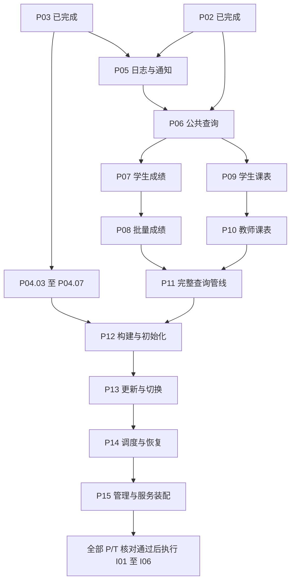

# 第一阶段并行开发方案

日期：2026-09-22；执行状态更新：2026-09-23。依据：[详细开发计划](PHASE1_DETAILED_DEVELOPMENT_PLAN.md)。

当前停止边界：按用户 2026-09-23 最新要求，先完成 P05、整分支合回 main 并通过合并 CI，随后暂停。P06 及之后不启动；下文后续批次保留为恢复开发时的依赖方案，不代表当前继续执行的授权。

启动基线：`1fddca49efc433f54f39098775a0bc23a19d7e53`；P01/T01—P03/T03 和 P04.01、P04.02 已完成。用户已于 2026-09-22 要求启动并行开发；第一批启动剩余 P04 与 P05。每小步在各自分支 review、push 和验证，整条开发线最后一步通过后才将完整分支合回 main，不逐小步合入 main。

## 1. 并行原则与依赖

将原计划的全局编号串行执行，调整为按依赖分线执行；每条线内部仍按原小步编号顺序执行。阶段内容、T 验收场景、业务契约和每小步的 review/push/CI 门槛保持不变。原计划中的全局顺序说明同步更新。本文件的整分支合并规则以用户最新要求为准。

原计划明确的阶段依赖如下；箭头表示前置阶段及对应 T 验收完成。同一开发线内按已验证分支继续（如 P07→P08、P09→P10）；跨线依赖须等整分支合入 main 且合并后的 CI 通过：



P11 对 P07、P09 的依赖通过 P08、P10 传递；P15 对 P01—P14 的依赖须全部核对，不能只检查 P14 的阶段标签。

## 2. 开发批次

| 批次 | 开发线 A | 开发线 B | 开始条件及汇合点 |
| --- | --- | --- | --- |
| 0：准备 | 协调会话确认公共接口、文件归属、上下文和测试证据格式 | 只读复核依赖与分工 | 恢复开发后执行；准备修改也须先 review，再 push 和等待 CI |
| 1：数据与可观测性并行 | P04.03 → .04 → .05 → .06 → .07 | P05.01 → .02 → .03 → .04 → .05 → .06 → .07 | P02/P03 已满足。P04 管合并，P05 管日志/通知；共享文件变更串行处理 |
| 2：公共查询 | 若 P04 未完成，继续原小步 | P06.01 → .02 → .03 → .04 → .05 → .06 | P05/T05 合入且 CI 通过即可开始 P06；无需为编号顺序等待 P04 |
| 3：成绩与课表并行 | P07.01—.06，随后 P08.01—.04 | P09.01—.07，随后 P10.01—.04 | P06/T06 合入且 CI 通过；各业务待定规则在相关小步前定稿。若 P04 仍占用写入会话，先完成它再释放名额 |
| 4：查询汇合 | P11.01 → … → .08 | 只读 review、核对证据 | P07/T07—P10/T10 全部完成；公共管线统一装配 |
| 5：更新与恢复 | P12.01—.06 → P13.01—.08 → P14.01—.07 | 只读 review、失败日志分析 | P12 开始前另核对 P04/T04。构建、发布、切换、恢复沿同一状态机顺序推进 |
| 6：装配与验收 | P15.01 → … → .07，再核对全部 P/T | 只读 review、部署说明核对 | P01—P14/T01—T14 全部完成后开始 P15；全部 P/T 完成后才启动 I 系列 |

最适合同时写代码的两组是 **剩余 P04 与 P05**、**P07→P08 与 P09→P10**。这两组直接由现有阶段依赖支持。

P11 的缓存与读者协调、P12 的候选构建与发布、P15 的管理接口与适配器，虽然存在可以拆开的实现部分，但原计划仍要求阶段内前序小步通过。本版保持这些阶段串行；将来若要进一步并行，必须先把小步依赖、接口及文件归属写清并修订执行计划，不能靠 Mock 跳过验收依赖。

## 3. 会话、分支与文件归属

建议同时运行一个协调会话、两个写代码的开发会话，以及按需运行的一个只读复核代理。当前工具最多支持四个并发代理（包含主代理），不为填满名额而增加写入者。

| 会话 | 职责 | 分支及工作目录示例 |
| --- | --- | --- |
| S0 协调 | 拆分小步、分配文件、共享契约、合并、main CI 和总进度 | 现有项目目录；main 由 S0 单独维护 |
| S1 开发 A | 第一批剩余 P04；第三批成绩线 | `feat/p04-merge`，独立 worktree；后续成绩线另建 `feat/grades-query` |
| S2 开发 B | 第一批 P05；随后 P06；第三批课表线 | `feat/p05-observability`，独立 worktree；后续分别使用 `feat/query-common`、`feat/timetable-query` |
| S3 复核 | 只读检查指定提交、测试充分性、错误路径和合并影响 | 针对明确的 base/head SHA；不修改开发会话正在编辑的文件 |

每个开发任务从已通过 CI 的确定提交创建独立 worktree 和命名分支。例如 `D:\JOTO_Projects\LocalDataMiddlePlatform-p04` 与 `D:\JOTO_Projects\LocalDataMiddlePlatform-p05`。分支或目录已存在时先核对用途，不覆盖。所有命令显式指定自己的工作目录；子代理默认共享文件系统，不能把“新代理”误认为已获得目录隔离。

建议代码归属如下，新增包名在启动前结合实际代码确定：

| 范围 | 唯一写入责任 |
| --- | --- |
| `internal/staging`、新增合并实现及相邻测试 | P04 会话；需要修改源规范化接口时交 S0 协调 |
| 新增事件、日志缓冲、通知组件及相邻测试 | P05 会话；接入现有 ingest/control/lifecycle 的共享修改交 S0 协调 |
| 公共查询基础 | P06 会话；进入成绩/课表并行前固定接口 |
| 新增成绩组件及专属 HTTP 处理器文件 | 成绩会话 |
| 新增课表组件及专属 HTTP 处理器文件 | 课表会话 |
| `internal/ports`、公共 DTO/路由、`internal/config`、`cmd`、共享存储/控制文件、`go.mod`/`go.sum`、迁移、CI、公共夹具 | S0 协调单一作者；可把具体文件临时授权给一条线，并通知另一条线只读 |
| `verification/Pxx.md`、`Txx.md` | 对应阶段会话维护；S0 合并时核对 |
| 原计划总复选框、跨阶段决策及本并行方案 | S0 维护 |

共享文件需要修改时，先报出具体接口和影响面，暂停受影响的小步；由唯一作者完成最小修改并验证，其他会话再同步已验证提交。迁移编号统一分配，不修改已应用迁移内容。不能在两个目录中同时写同一个共享协议的不同版本。

本仓库部分架构文档、源文档和本地工具被 Git 忽略，新 worktree 不会自动带入。创建任务时提供必要文档的只读绝对路径，或仅复制经过检查的开发说明与合成夹具；明确继承 `D:\JOTO_Projects\AGENTS.md`。不得整目录复制凭据、`.env` 或真实人员样本。主目录已有的未跟踪前端规划不属于本次交付，不随分支批量加入。

## 4. 每个小步的 review、push、CI 与合并

1. S0 只派发依赖已满足的小步，写明基线 SHA、worktree、分支、允许修改文件及对应 T 场景。
2. 开发会话完成本小步的实现、邻接测试和必要记录；本地只做格式及静态差异检查，不运行 unit tests。
3. 开发者自查后，由 S0 或 S3 对实际 diff 复核。发现问题就在同一小步修复并重新 review，直到没有未解决问题。
4. 明确暂存本步文件，使用 `type: ...` 消息提交并 push 到自己的功能分支，例如 `feat: compare sealed source content`、`fix: preserve pending log deliveries`。不用批量 `git add .`，不把其他会话或用户文件带入。
5. 等待该次 push 的准确 commit SHA 对应的 GitHub Actions Linux CI。当前工作流对功能分支 push 也会运行。须检查完整作业的 unit tests、race、vet、构建等适用检查，不能只看最新一次绿色记录。
6. CI 失败：在本小步追加修复 → review → `fix: ...` 提交/push → 等待新 SHA 的 CI，循环到通过。取消、跳过、没有实际执行的用例均不算通过。
7. 本小步分支 CI 通过后，可开始本线下一个小步；另一条无依赖开发线不需要等待。小步持续提交和 push，但整条开发线最后一步完成前不合入 main。第一批的分支终点分别为 P04.07/T04 全部通过、P05.07/T05 全部通过；成绩线终点为 P08/T08，课表线终点为 P10/T10。
8. S0 在整条线完成后，对完整分支及其与当前 main 的组合差异复核，以明确的已验证最终 SHA 合并整条分支，保留各小步提交历史。使用 `--no-ff` 合并，合并消息仍以 `type: ...` 开头。存在冲突时先修复并重新 review，必要时使用独立集成分支 push 跑 CI。禁止强推覆盖历史。两条线不必等彼此结束才能交付自己的完整分支。
9. main 每次整分支合并 push 后等待其准确 SHA 的 CI；通过前不合入另一条分支。组合回归失败由 S0 暂停合并并安排修复，修复仍执行 review/push/CI 循环。无关开发线可继续，但依赖阶段不能提前开始。
10. 阶段全部小步及 T 场景通过，才开放同线依赖阶段；跨线依赖阶段还须等完整分支合入 main 且 main CI 通过。S0 核对总计划状态，并区分“分支已验证”“已合入并验证”“阶段完成”。

开发线同步 main 时保留自己的小步边界；引入其他提交或解决冲突后，重新检查并等待新提交 CI，不把旧结果沿用到新代码。记录每步 commit、review 结果、功能分支 CI、main 合并提交及其 CI 链接。CI 链接可随下一次必要记录更新补入，不为补链接无限产生提交。

测试仍只使用仓库 Mock 或合成数据；unit tests 只在 GitHub Actions Linux 执行，I01—I06 在全部 P/T 完成后执行。不调用真实源、不读 `source_samples`、不向外部邮箱发信。

## 5. 启动前需要落实的契约

这些是原计划已有的业务门槛，不应由并行会话分别猜测：

- P06：公共错误结构、参数上限、固定排序与读取句柄。
- P07：文字成绩输出、代码字典、课程同号冲突处理。
- P09：日期/周次/节次格式、多教师分隔、未排课表达；课程关联规则与成绩线保持一致。
- P11：跨请求快照传输凭据及保留期、无变化轮次的同步时间与缓存元数据处理。

S0 维护唯一决策记录；技术实现参数按原计划由开发者确定。接口文档明确未定的业务语义需要落实后才能完成相关小步，其他无依赖线可继续。前端规划不自动加入本阶段并行实施范围。

## 6. session 的实际执行方式

官方支持使用独立 worktree 运行并行聊天，也支持在主聊天下创建子代理线程。参考 [Worktrees](https://learn.chatgpt.com/docs/environments/git-worktrees) 与 [Subagents](https://learn.chatgpt.com/docs/agent-configuration/subagents)。

当前会话有创建子代理、分配工作和汇总结果的工具。因此恢复开发时，可以自动创建开发子会话，并要求每个写入代理只在预先创建的独立 worktree 中工作。主会话持续协调 review、CI 和合并。

当前工具未提供创建应用侧独立顶层聊天的入口，不能承诺自动在侧栏新建那种 session。如果需要独立顶层聊天，可在应用中选择 Worktree 新建，并使用下面的任务说明。新建终端进程不算新建开发会话。本次启动采用开发子代理加独立 worktree。

### 每个开发会话的任务说明

```text
任务：只开发指定阶段/小步；禁止扩展到后续阶段。
基线：<已通过 main CI 的 SHA>
目录：<独立 worktree 绝对路径>
分支：<唯一功能分支>
上下文：详细计划、本并行方案、适用 AGENTS.md、必要只读架构文档。
允许写入：<具体目录/文件>；其余共享文件先交协调会话分配作者。
依赖：<已完成 P/T、已定稿业务契约>
验收：<本小步 T 场景、失败路径、回归范围>
循环：实现和测试代码 → review/修复 → type: 提交 → push → 等待该 SHA CI。
CI 失败只修复当前小步，通过后再开始同线下一小步。
禁止本地 unit tests、提前 I 测试、真实数据/邮件、改 main 或强推。
每步汇报：SHA、文件、review 结论、CI URL/结果、待合并状态及阻塞项。
```

恢复后第一批派发：S1 从 P04.03 开始；S2 从 P05.01 开始。S0 在派发前确认共享文件责任和两条线的共同基线。吞吐提升取决于独立任务长度及 GitHub runner 排队情况，不承诺固定倍数加速。
