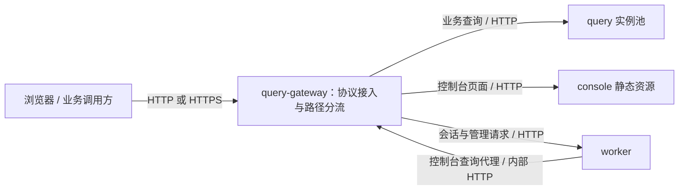

# query-gateway 统一入口与 HTTP / HTTPS 部署方案

编写日期：2026-10-10。进度：**剩余 GW-P01—GW-P04 实现、测试代码和静态复核已完成；新增运行测试待 Linux CI，GW-T/GW-I 不提前勾选。** 交付与限制见 [专项验收报告](QUERY_GATEWAY_ACCEPTANCE.md)。

本计划沿用 [第一阶段详细开发计划](PHASE1_DETAILED_DEVELOPMENT_PLAN.md)及 [第二阶段详细开发计划](PHASE2_DETAILED_DEVELOPMENT_PLAN.md)的“需求 → 方案 → 分阶段小步开发 → 同编号单元测试 → 集成验收”结构。网关属于独立部署专项，使用 **GW-P01—GW-P04 / GW-T01—GW-T04、GW-I01—GW-I05**，避免占用业务接口计划编号；原稿 G01—G04 汇总步骤由本版阶段及小步替代，不作为完成记录。

本专项不依赖第二阶段五个新接口交付，也不增加前端页面或管理接口。验收使用实施时已经注册的业务接口，不把网关可达等同于未开发接口可用。

审查更新：2026-10-10。已对照当前 Compose、网关/worker 入口、Vite 代理及 CI 脚本修订配置兼容、开发入口、预检和切换顺序；以下完成框按实际实现和运行证据更新，阶段框仅在全部子项满足时勾选。

执行顺序更新：用户明确要求“你不需要管配额，先开发吧，把剩下的都开发完再说”。因此完成全部剩余开发后统一推送与运行 CI，不再等待工件配额、不继续清理或备份。此指令覆盖下文原有逐小步 CI 门禁；测试仍仅在 Linux CI 执行，未运行项不记为成功。

## 1. 需求

### 1.1 本次交付范围与现状

| 范围 | 当前事实 | 本次工作 |
| --- | --- | --- |
| 查询入口 | query-gateway 监听内部 8080，经独立宿主机端口转发 query 实例池 | 增加统一外部入口，承接 HTTP / HTTPS、页面和管理请求分流 |
| 控制台 | console 的 Nginx 同时提供静态资源和 worker 代理，并发布独立端口 | 将管理分流迁到网关，保留静态服务与 SPA 路由 |
| 证书 | 当前网关未配置 TLS 监听和证书挂载 | `.env` 配置两项路径，Compose 直接只读挂载；无证书默认 HTTP |
| 会话 | worker 接收 `CONSOLE_COOKIE_SECURE`，查询代理使用网关内部 HTTP | 统一部署时按入口协议派生 Cookie 设置，保留内部查询链路 |
| 运维与验证 | 已有 Compose 检查、查询多实例检查及部署脚本 | 同步迁移入口地址，增加两种协议、失败边界、切换与续期验收 |

交付包括网关配置与启动逻辑、Compose 和配置模板、必要的 console/worker 接入修改、部署脚本、对应测试及实际验收记录。不修改业务接口契约、数据库结构、数据卷布局或查询发布机制。

### 1.2 已确定的功能规则

由现有 `query-gateway` 承担统一入口，集中处理 HTTP / HTTPS 接入、按路径分流及 query 多实例负载均衡。浏览器控制台与业务 API 共用一个入口地址，容器之间继续通过内部 HTTP 通信。

1. 不配置证书时默认使用 HTTP；证书和私钥均配置且有效时使用 HTTPS，在 `query-gateway` 的 Nginx 终止 TLS。只配置一项或文件无效时启动失败，不自动降级。
2. 页面、管理请求与业务查询的分流规则放在 `query-gateway`。
3. `.env` 中证书链文件和私钥文件的宿主机绝对路径可以同时留空；配置后由 `compose.yaml` 直接引用并只读挂载进网关。
4. 单站点按路径分流，域名不设为必填配置；HTTPS 证书必须覆盖客户端实际访问的域名。
5. 保留独立 `console` 容器提供前端静态资源，query 继续支持多实例，worker 保持现有职责。

这里的“两个证书文件”具体指**一份证书链文件和一份配套私钥文件**，不是两套域名证书。证书链采用 PEM 格式，包含站点证书及所需中间证书；私钥也采用 Nginx 可读取的 PEM 格式。

### 1.3 必须保持的公共约束

| 范围 | 实施要求 |
| --- | --- |
| 协议选择 | 证书及私钥均空用 HTTP，均有效用 HTTPS，半配置或错误文件拒绝启动；环境名及端口号不决定协议 |
| 权限 | 路径分流不授予权限；query 校验业务 key，worker 保留会话、权限及 CSRF 检查 |
| 内部链路 | worker 查询仍走网关内部 8080；内部入口不转发管理请求，不形成代理循环 |
| 运行边界 | 沿用非 root、只读根文件系统和现有网络隔离；仅发布一个外部入口端口 |
| 查询行为 | 保留动态 DNS、最少连接分配、请求预算和不重放已发送非幂等 POST 的约束 |
| 配置与日志 | 私钥不入仓库或镜像；日志不记录 Cookie、业务 key、快照令牌、私钥内容或完整业务正文 |
| 开发方式 | 按小步串行开发、测试代码、复核和修复；测试在 GitHub Actions Linux 运行，本地只编辑及静态复核 |

### 1.4 实施前需验证的技术边界

| 事项 | 处理位置 | 完成标准 |
| --- | --- | --- |
| 空路径的 `/dev/null` 占位挂载 | GW-P01 / GW-P03、GW-I01 | 在真实 Linux Compose 中证明无证书可启动，非空错误路径不会被占位掩盖 |
| Nginx 模板与可写配置位置 | GW-P02、GW-I01 / GW-I02 | UID/GID 65532、只读根目录、现有 tmpfs 下可校验并启动 |
| 旧端口与脚本调用点 | GW-P03 | 列出旧变量和地址的全部引用，同步迁移，旧独立端口不再发布 |
| 前端开发代理 | GW-P03、GW-I03 | Vite 改连统一网关；HTTP 开发和 HTTPS 验收分开处理，不保留失效的 18081 默认目标 |
| 域名与证书身份 | GW-I02 | 使用合成测试域名及 CA 验证正确域名成功、错误域名失败；不预设用户生产域名 |

上述边界是待验证的实施事项，不表示当前环境已经验证可行。挂载与只读运行检查须在对应小步的隔离容器检查中先通过，再启用默认部署；I 系列复验最终组合，不能把基础可行性拖到全部实现后才确认。实现调整不得改变第 1.2 节已确认的协议与分流规则。

## 2. 方案

### 2.1 开发与核对方式

`GW-Pxx.yy` 是开发、复核和 CI 检查点。每步交付一个完整可验证行为，包含正常/错误路径、对应测试代码和必要说明；先 code review，修复后复核。按用户最新授权连续完成剩余开发后 commit/push，再统一执行对应 SHA 的 CI。本专项已获用户授权实施及复核后推送，逐步更新实现、测试和验收记录。

P 复选框表示实现、测试代码及复核完成；T 复选框只表示对应测试已实际通过，两者分别记录。本次按用户最新要求先完成各阶段 P，再统一执行 T 与 I；此调整不改变验收通过标准。配置渲染、Bash 语法、镜像构建与 `nginx -t` 是配置/构建检查，不能冒充单元测试或真实链路验收。

每个小步必须保持当前部署可运行。GW-P01/GW-P02 先交付未启用的公共组件与模板；GW-P03 的统一入口切换同时交付 Compose、console 路由、worker 协议接入及受影响脚本，不能留下依赖后续步骤才恢复可用的默认部署。

记录沿用 `development_docs/verification/`，分别使用 `GW-Pxx.md`、`GW-Txx.md`、`GW-Ixx.md`，记录小步决定、变更、复核、回退边界、SHA、Actions 链接、实际测试名、命令/退出码和通过/失败/跳过数量。未执行、跳过、超时和“无测试可运行”不能记为通过；不预建空的通过报告。

**开发顺序：GW-P01 配置规则 → GW-P02 网关模板与启动 → GW-P03 统一部署接入 → GW-P04 切换续期与交付 → GW-I01—GW-I05。**

### 2.2 当前实现与目标链路

当前 query-gateway 监听容器端口 `8080`，将请求转给 query 实例；控制台另有宿主机入口，其 Nginx 同时提供静态页面和代理 worker。目标是把对外分流集中到 query-gateway。



worker 的 `CONSOLE_QUERY_URL=http://query-gateway:8080` 保持可用。网关的内部 `8080` 入口只提供查询及 query 健康探针代理，不承接页面或管理请求，因此不会形成 worker → gateway → worker 的循环。

### 2.3 外部统一入口路由

HTTP 与 HTTPS 模式共用以下分流规则，协议切换不改变业务路径。

| 请求路径 | 目标 / 行为 | 约束 |
| --- | --- | --- |
| `/` | 重定向至 `/console/` | 使用相对地址，保留浏览器的域名、协议和外部端口 |
| `/console` | 重定向至 `/console/` | 同上 |
| `/console/…` | `console:8080` | 保留路径，由 console 处理静态资源与 SPA 深层路由 |
| `/console-api/…` | `worker:8081` | 保留会话 Cookie、CSRF 及控制台请求头 |
| `/admin/v1/tasks/…`、`/admin/v1/tables/…` | `worker:8081` | 迁移现有管理路由白名单，仍由后端检查会话及权限 |
| `/api/v1/sicp/…` | `query_instances` | 保留业务 `X-API-Key`，由 query 鉴权并识别已实现接口 |
| 其他路径 | `404` | 不把未知路径转到 worker，也不返回 SPA 页面 |

分流只确定上游，不授予访问权限。管理分支延续当前 console 代理对外来 `Authorization`、`X-API-Key` 的清除规则；业务查询分支必须保留 `X-API-Key`。后续新增管理接口时，按实际路由逐项扩展白名单。

路由匹配须明确路径边界：例如 `/console-extra`、`/console-api-extra`、`/admin/v1/tasks-extra/` 不命中对应分支。代理保留原始路径、查询参数和请求体，不通过带 URI 的 `proxy_pass` 意外去掉前缀；业务及管理 API 不增加尾斜杠跳转，不改变 POST 方法。`/` 与 `/console` 的相对跳转仅用于 GET/HEAD，其他方法返回 405。外部 `/livez`、`/readyz` 不公开；内部探针及登录后的控制台健康代理继续可用，原先依赖外部探针的调用方需迁移。

### 2.4 内部 HTTP 与健康检查

- 网关保留容器端口 `8080`，供 worker 查询代理访问；只开放业务查询前缀以及 `/livez`、`/readyz`，健康路径沿用 query 的探针语义。
- 网关现有健康检查可继续访问 `http://127.0.0.1:8080/livez`。该检查不代表外部协议、证书、页面及登录链路已验收，HTTP / HTTPS 分别设置集成验证。
- 只由网关发布一个统一宿主机端口，根据证书配置选择 HTTP 或 HTTPS；query、console、worker 及网关内部 `8080` 不发布宿主机端口。日常诊断使用 `docker compose exec`。
- 外部入口固定使用容器端口 `8443`，无证书时监听普通 HTTP，有证书时监听 HTTPS；端口数字本身不决定协议。内部 `8080` 始终独立保留，不能直接作为外部 HTTP 入口，否则无法承接页面和管理路由。
- 两种外部协议互斥，不同时开放，也不配置 HTTP → HTTPS 跳转。切换后调用方使用对应协议；以后若增加独立 HTTP 跳转入口，再单独处理。

### 2.5 `.env` 与协议选择

默认 HTTP 配置，无需证书：

```dotenv
SICP_GATEWAY_PORT=18080
SICP_TLS_CERT_FILE=
SICP_TLS_KEY_FILE=
```

此时通过 `http://服务器地址:18080/console/` 访问。启用 HTTPS 时，填写运行 Docker Engine 的宿主机上的文件路径，例如：

```dotenv
SICP_GATEWAY_PORT=443
SICP_TLS_CERT_FILE=/etc/sicp/tls/fullchain.pem
SICP_TLS_KEY_FILE=/etc/sicp/tls/privkey.pem
```

协议只由两项证书配置决定，不由 `ENVIRONMENT` 或端口号决定：

| 证书链路径 | 私钥路径 | 启动行为 |
| --- | --- | --- |
| 未设置或空值 | 未设置或空值 | 使用 HTTP，不加载 TLS 文件 |
| 非空 | 非空，且两份文件有效、可读、配套 | 使用 HTTPS |
| 仅一项非空 | 另一项未设置或空值 | 配置错误，启动失败 |
| 两项非空但任一文件不存在、不可读、内容无效或不配套 | — | 启动失败，不回退 HTTP |

只含空白的路径按非法配置拒绝，不作为关闭 HTTPS 的方式；Linux 非空路径须为绝对路径，拒绝换行、NUL 等控制字符，合法空格及 `$` 等字符按字面保留，不 trim 或执行。已启用 HTTPS 后文件丢失或损坏会使下次预检/启动失败；已运行进程可能继续使用内存中的旧证书，本方案不提供文件变化实时监控。只有明确清空两项配置并重新部署，才切换为 HTTP。

本方案中的“文件有效”指可读取、PEM 可解析且证书与私钥配套，私钥须能非交互加载；不提供私钥口令输入流程。证书域名、有效期与信任链仍由客户端和上线后检查验证，不能把 Nginx 可加载等同于浏览器可信。

`.env` 只保存文件路径，不保存证书或私钥正文。发布到仓库的 `.env.example` 提供配置项及说明，真实路径由部署者填写，私钥不进入源码仓库或镜像。

统一入口后，原 `SICP_QUERY_PORT`、`SICP_CONSOLE_PORT`、`SICP_WORKER_PORT` 不再用于默认对外发布，由 `SICP_GATEWAY_PORT` 统一配置，默认 `18080`。启用 HTTPS 时可以保留该端口并使用 `https://服务器地址:18080`，也可以改为 `443`；多套环境并存时使用不同端口。端口不会随证书配置自动变化。实施时同步迁移脚本和文档，删除旧端口映射。

Compose 在 worker 中固定注入内部标记 `SICP_GATEWAY_MANAGED=true`，不提供 `.env` 开关。标记为 true 时，worker 根据同一对证书配置自动设置 `CONSOLE_COOKIE_SECURE`：HTTP 为 `false`，HTTPS 为 `true`，半配置直接失败。标记未设置或为空时保留旧入口的显式 Cookie 配置行为，非空未知值拒绝；这样 GW-P03.01 可以兼容尚未切换的 Compose 和直接进程运行。

统一部署模板不再要求用户填写 `CONSOLE_COOKIE_SECURE`，Compose 移除旧的手动传值；已有 `.env` 的旧值不参与统一部署的协议判断。原三个端口变量退出使用，已有自定义 `SICP_QUERY_PORT` 需显式迁到 `SICP_GATEWAY_PORT`，不静默猜测三个旧端口中的哪一个应继续使用。

### 2.6 Compose 证书挂载

以下是拟合并进现有服务的配置片段，不是完整可运行的 Compose 文件：

```yaml
services:
  query-gateway:
    environment:
      SICP_TLS_CERT_FILE: "${SICP_TLS_CERT_FILE:-}"
      SICP_TLS_KEY_FILE: "${SICP_TLS_KEY_FILE:-}"
    ports:
      - "0.0.0.0:${SICP_GATEWAY_PORT:-18080}:8443"
    volumes:
      - type: bind
        source: "${SICP_TLS_CERT_FILE:-/dev/null}"
        target: /etc/nginx/tls/fullchain.pem
        read_only: true
        bind:
          create_host_path: false
      - type: bind
        source: "${SICP_TLS_KEY_FILE:-/dev/null}"
        target: /etc/nginx/tls/privkey.pem
        read_only: true
        bind:
          create_host_path: false
  worker:
    environment:
      SICP_GATEWAY_MANAGED: "true"
      SICP_TLS_CERT_FILE: "${SICP_TLS_CERT_FILE:-}"
      SICP_TLS_KEY_FILE: "${SICP_TLS_KEY_FILE:-}"
```

Compose 从根目录 `.env` 插值取得源路径，容器内使用固定路径，Nginx 无需直接读取 `.env`。网关和 worker 收到相同的路径配置以判断协议，worker 不挂载或读取私钥。沿用 Compose 的优先级：启动进程中同名环境变量可以覆盖 `.env`，部署脚本须避免意外覆盖。[Compose 插值说明](https://docs.docker.com/compose/how-tos/environment-variables/variable-interpolation/)

为保持单个 `compose.yaml` 且允许无证书启动，拟在现有 Linux 部署环境中以宿主机 `/dev/null` 作为空路径的只读挂载占位，HTTP 模式不读取这些挂载。传入容器的原始配置仍为空，不能根据占位文件是否存在判断协议。非空路径不会被替换为占位；显式把 `/dev/null` 填作证书路径也必须在 TLS 文件检查中失败。这种挂载方式须在 GW-P03 的配置检查及 GW-I01 的真实 Linux Compose 验证中覆盖。

挂载采用长语法并关闭 `create_host_path`，源路径不存在时启动失败，不自动创建同名目录；文件存在性、普通文件类型及可读性还需在网关启动时检查。[Compose 挂载说明](https://docs.docker.com/reference/compose-file/services/#volumes)

### 2.7 Nginx 协议选择与启动检查

启动入口先按第 2.5 节检查两项配置，再选择 HTTP 或 HTTPS 模板。两种模板共用路径分流配置，生成完整主配置 `/tmp/sicp-nginx/nginx.conf`，同时包含必要的 events/http、PID、临时目录及日志配置；`nginx -t` 与启动必须显式指定同一主配置。不得只生成 server 片段后误传给 `nginx -c`，也不再包含旧的 `/etc/nginx/conf.d/default.conf`，避免重复监听。模板替换只处理明确的部署占位符，必须保留 `$scheme`、`$http_host` 等 Nginx 运行时变量，不能对整个配置无差别执行 envsubst。

新增网关入口 `--check-config` 模式：执行同样的模式选择、文件检查及 `nginx -t` 后退出，不启动监听、不要求 query/worker/console 已启动。检查禁用交互输入并设置有限超时，加密私钥不得等待口令。上游全部使用可运行时解析的 Docker DNS 配置，预检不以依赖服务健康为前提。`scripts/sicp.sh validate` 在已有应用配置检查之外，执行 `docker compose run --rm --no-deps query-gateway --check-config`；一次性容器不发布服务端口，因此可在现有入口运行时检查新挂载与新配置。

临时配置、PID、client/proxy 临时目录均留在 `/tmp`，沿用 UID/GID 65532 和只读根目录；启动脚本使用 `exec` 传递 SIGQUIT。响应代理禁用落盘缓存（`proxy_max_temp_file_size 0`），保持有限内存缓冲与慢客户端背压，避免多个大查询响应耗尽现有 16 MiB tmpfs。请求体限制仍按路由生效，并在 GW-I04 覆盖临时目录空间和超时边界。[Nginx 代理缓冲说明](https://nginx.org/en/docs/http/ngx_http_proxy_module.html#proxy_max_temp_file_size)

HTTP 模式的外部监听片段：

```nginx
listen 8443 default_server;
server_name _;
absolute_redirect off;
```

HTTPS 模式的外部监听片段：

```nginx
listen 8443 ssl default_server;
server_name _;
ssl_certificate /etc/nginx/tls/fullchain.pem;
ssl_certificate_key /etc/nginx/tls/privkey.pem;
ssl_protocols TLSv1.2 TLSv1.3;
absolute_redirect off;
```

根据模式只启用其中一套外部 `server`，HTTP 模板不含 `ssl_certificate` 等 TLS 指令；内部 HTTP 使用独立 `server`。外部容器监听非特权端口 `8443`，宿主机通过 `SICP_GATEWAY_PORT` 映射进入，沿用当前网关的非 root 运行方式。

HTTPS 模式下，证书和私钥必须能被网关 UID/GID `65532:65532` 读取。部署时通过所属组或 ACL 提供必要权限，不把私钥开放为所有用户可读。启动入口先检查挂载文件为可读普通文件，再执行 `nginx -t`；缺文件、不可读、无效证书或证书与私钥不匹配时明确失败，不回退到 HTTP。`nginx -t` 不替代客户端对域名、有效期及信任链的校验。[Nginx HTTPS 配置说明](https://nginx.org/en/docs/http/configuring_https_servers.html)

### 2.8 域名与证书身份

**当前单站点方案可以不在 `.env` 中填写域名，但 DNS 解析不能替代 HTTPS 证书的域名校验。**

HTTP 模式可以直接使用 IP 或已解析的域名访问，无证书匹配要求；以下 TLS 规则只适用于 HTTPS 模式。

| 层次 | 负责什么 | 本方案如何处理 |
| --- | --- | --- |
| DNS | 将访问域名解析为入口 IP | 在 DNS 服务商处配置；普通 A/AAAA 记录不指定 HTTP 服务端口 |
| Nginx 站点选择 | 根据监听地址、端口及请求主机名选择站点 | 单个默认站点接收请求，再按路径分流 |
| TLS 身份校验 | 客户端确认服务端证书覆盖正在访问的域名且可信 | 部署对应域名的证书链与私钥，客户端正常校验 |

例如 `sicp.example.com` 解析到服务器 IP，证书覆盖 `sicp.example.com`，服务器发布 `443`，即可通过 `https://sicp.example.com/console/` 访问。若发布 `18443`，地址须写为 `https://sicp.example.com:18443/console/`。把地址换成 IP 访问时，证书还必须包含对应 IP 的 SAN；只包含域名的证书不能因此通过 IP 身份校验。

`server_name _` 是惯用占位值，不是通配符；实际兜底由 `listen … default_server` 决定。这里默认接收未匹配的 Host，不构成域名白名单。[Nginx 请求与默认站点选择](https://nginx.org/en/docs/http/request_processing.html)

以后出现下列需求时，再增加显式域名配置及对应模板：同一入口按域名分流到不同站点、为不同域名选择不同证书、限制允许的 Host，或必须生成固定域名的绝对地址。多证书选择需要结合 SNI 和站点配置。[Nginx 多域名 HTTPS](https://nginx.org/en/docs/http/configuring_https_servers.html#sni)

### 2.9 模块边界与实施细节

1. **查询负载均衡。** 复用现有 `least_conn`、Docker DNS 动态解析及 `QUERY_REPLICAS=1—32`；保留查询超时和连接复用设置，不重放已经发送给后端的非幂等 POST。
2. **控制台静态服务。** `frontend/nginx.conf` 保留静态资源、SPA 回退和安全响应头；管理请求代理迁到网关，原管理响应的 `Cache-Control: no-store` 等适用响应头也随之迁移。网关不缓存会话或查询响应，保留后端 JSON 状态/响应体，不用 HTML 错误页覆盖 API 错误。未知 API 不得落入 SPA 回退。
3. **容器依赖。** 保留网关对 query 健康状态的依赖。现有 console 依赖网关，不能再添加网关对 console 的启动依赖形成环；console/worker 上游在请求时通过 Docker DNS 解析，允许暂时不可用时返回上游错误，并在容器重建后恢复。
4. **会话与代理头。** worker 按第 2.5 节内部标记派生 Cookie 设置。各代理 location 显式包含完整公共头配置：`Host $http_host`、`X-Forwarded-Proto $scheme`、`X-Forwarded-For $remote_addr`、`X-Real-IP $remote_addr`，清除客户端的 `Forwarded`、`X-Forwarded-Host`、`X-Forwarded-Port`；不把容器 8443 当作外部端口。管理分支另清除 Authorization 和业务 key，保留 Cookie/CSRF。Nginx 在 location 自定义 `proxy_set_header` 后不会自动继承上层同组设置，必须用共用 include 或显式配置保证齐全。本方案按客户端直达网关设计，额外的 CDN/外部 TLS 终止不在本次信任配置内。[Nginx 代理头继承规则](https://nginx.org/en/docs/http/ngx_http_proxy_module.html#proxy_set_header)
5. **请求限制与日志。** 查询分支保留现有 `1m` 请求体上限，管理分支保留 `64k` 上限；超时按现有接口预算配置。日志不记录 Cookie、API Key、私钥内容、快照令牌或完整业务正文。
6. **开发环境。** 默认两项路径留空，直接使用 HTTP。CI 同时覆盖无证书 HTTP 与有证书 HTTPS；TLS 场景使用覆盖测试主机名的合成证书，客户端显式信任测试 CA，不以跳过证书校验代替验证。
7. **证书续期。** 文件 bind mount 可能仍指向被替换前的文件，尤其是续期工具原子替换文件或切换软链接时。更新宿主机文件后，通过第 4.2 节 `gateway-renew` 完成预检、网关重建及新证书验证；不保证仅 `nginx -s reload` 就能读取新文件。证书链和私钥须成套更新，在更新期间不执行重建。网关单实例重建可能短暂中断入口，运维需选择合适窗口。
8. **Vite 开发代理。** 迁移 `frontend/vite.config.ts` 的默认目标至 `http://127.0.0.1:18080`，通过网关访问管理路由；自定义目标仍可使用 `SICP_WORKER_TARGET`，说明其实际可指向统一网关，更新 `frontend/README.md` 的 SSH 转发例子。HTTP Vite 页面默认配合同为 HTTP 的后端；HTTPS 全链路测试通过实际网关提供的静态页面执行，不依赖 HTTP Vite 页面代理 HTTPS 后端来验证 Secure Cookie，也不通过关闭证书校验解决开发配置问题。
9. **浏览器状态与协议回退。** 现有 `sicp_session` Cookie 使用 `Path=/`，且不按端口隔离。同一主机 HTTPS → HTTP 前可先在 HTTPS 下退出登录；未退出的客户端需要在浏览器清理该站点 Cookie 后重新登录，不能保证 HTTP 响应能覆盖残留的同名 Secure Cookie。不同环境若共用主机名，单靠端口不能隔离会话，应分别使用主机名或浏览器配置。为保留显式 HTTP 回退能力，本方案不新增 HSTS；已有 HSTS/父域策略须在部署前确认。验收使用非 localhost 测试域名，避免浏览器对 localhost 的特殊处理掩盖问题。[Cookie 存储与 Secure 覆盖规则](https://datatracker.ietf.org/doc/html/draft-ietf-httpbis-rfc6265bis-22#section-5.7)

实现触点至少包括：`deploy/QueryGateway.Dockerfile`、网关模板/入口、`deploy/worker-entrypoint.sh`、`deploy/Dockerfile`、根 `.dockerignore`、`compose.yaml`、`.env.example`、`frontend/nginx.conf`、`frontend/vite.config.ts`、`scripts/sicp.sh`、`scripts/check-compose-config.py`、`scripts/check-compose.sh`、`scripts/check-query-replicas.py`、`scripts/query-student-grades.py`、`.github/workflows/ci.yml` 及部署/前端说明。共享脚本若放在 deploy 下，须同时加入两个镜像的 COPY 和各自构建上下文允许项；根 `.dockerignore` 当前只放行少数入口文件，不能假定新脚本会自动进入镜像。证书夹具放在构建上下文外，不复制进镜像。

### 2.10 分阶段开发步骤与对应 unit tests

阶段及阶段内的小步均按编号串行执行，每步同时交付实现、对应测试代码、必要说明和代码复核。下列复选框表示实际进度；配置片段仅用于说明目标，不作为当前已生效配置。

- [x] **GW-P01：协议与部署配置规则完成**

    依赖：当前第一阶段部署能力及本计划第 1.2 节决定。产物：可独立测试的协议选择、路径与端口校验组件，以及合成配置夹具；暂不切换现有部署入口。

    - [x] **GW-P01.01：协议选择与错误分类。** 实现两项证书路径的全空、成对、半配置与纯空白判定，明确 ENVIRONMENT 和端口不影响协议。网关与 worker 复用同一规则或同一组独立契约用例，错误只报告配置项及类别。Unit tests：GW-T01-01—GW-T01-03。提交 `2ea9176`；四个测试方法通过，原 CI 工件受配额阻塞；后续按用户最新指令连续开发。
    - [x] **GW-P01.02：宿主机路径与端口边界。** 明确 Linux 绝对路径、包含空格的合法路径、控制字符拒绝、端口范围 1—65535、缺省端口与空值行为；真实路径按原值传递，不执行 `.env` 内容、不把路径当作 Shell 代码。两项路径未配置时选择占位挂载，非空配置不替换为占位。端口与路径校验纳入宿主机部署预检，网关/worker 入口重复执行其消费的协议与路径检查；直接 Compose 绕过宿主机预检时仍有文件挂载及启动检查。Unit tests：GW-T01-04—GW-T01-06。

- [x] **GW-P02：网关双协议模板与启动能力完成**

    依赖：GW-P01/GW-T01。产物：HTTP/HTTPS 模板、共用路由和启动组件；通过独立 CI 入口验证，现有默认部署在 GW-P03 接入前保持可运行。

    - [x] **GW-P02.01：外部与内部配置生成。** 外部 8443 按协议选择模板，内部 8080 仅查询与探针；共用第 2.3 节路由，保留请求限制、上游超时、DNS、负载均衡、完整 location 头设置和有限缓冲。生成完整主配置到 `/tmp`，固定路径和受控替换，防止将宿主机路径插入指令。Unit tests：GW-T02-01—GW-T02-03；另执行真实 Nginx 配置检查及非 root/只读容器检查。
    - [x] **GW-P02.02：文件验证与失败关闭。** HTTPS 分支检查挂载文件类型、读取权限，再执行 `nginx -t`；任一步失败都不启动监听，不尝试 HTTP 模板。HTTP 分支不读取证书占位；实现不启动服务的 `--check-config`，在上游服务均不存在时也可预检。保留 `QUERY_REPLICAS` 边界及 `exec nginx` 信号传递。Unit tests：GW-T02-04—GW-T02-06；本步容器检查覆盖真实无效 PEM、错配私钥、加密私钥及 UID 权限，GW-I02 再验最终部署。

- [x] **GW-P03：统一部署与控制台接入完成**

    依赖：GW-P02/GW-T02。产物：可使用一个外部地址访问的 Compose 部署、控制台静态服务、worker 协议接入及迁移后的已有检查脚本。

    - [x] **GW-P03.01：worker 协议与 Cookie 接入。** 依据内部 `SICP_GATEWAY_MANAGED` 标记区分统一部署和旧入口，按成对路径派生 Secure Cookie，覆盖旧手动值；标记未设置时保持直接进程及旧 Compose 行为。协议组件只读取配置，不挂载私钥；更新共享脚本 COPY/构建允许项，保留查询代理、会话及 CSRF 规则。Unit tests：GW-T03-01—GW-T03-03。
    - [x] **GW-P03.02：成套启用统一入口。** 同步修改 `.env.example`、`compose.yaml`、镜像/启动接入、`frontend/nginx.conf`、Vite 代理及使用旧端口的部署/检查脚本。移除旧端口发布和 console 管理代理，保留 SPA 及安全响应头；避免启动依赖环，确保上游重建后重新解析 DNS。`validate` 接入网关预检；更新部署及前端开发说明。Unit tests：GW-T03-04—GW-T03-06，回归现有查询/管理鉴权；另运行双模式 Compose 渲染、真实空/非空路径挂载检查、镜像构建、`nginx -t` 和已有部署烟测，失败不能留到下一步修复。
    - [x] **GW-P03.03：脚本地址与配置读取统一。** 将部署、查询副本检查及控制台检查的协议、主机、端口构造收敛到一致规则，保留显式 base URL 优先；支持非默认端口及测试 CA。从 Compose 渲染结果中只读取所需字段，不输出含密码的整份 JSON，不通过 `source .env` 或自写 dotenv 解析器读取。注意渲染输出中的美元转义不能再次插值；以实际传入容器的值为预期。Unit tests：GW-T03-07—GW-T03-09；已有脚本可用性必须在上一小步切换时已恢复，本步只收敛重复逻辑。

- [x] **GW-P04：协议切换、证书续期与交付完成**

    依赖：GW-P03/GW-T03。产物：切换及续期的运维执行路径、错误处理、完整配置与回退说明，以及 GW-I01—GW-I05 自动化入口。

    - [x] **GW-P04.01：明确重建目标与执行顺序。** 在 `scripts/sicp.sh` 增加第 4 节的 `gateway-apply` / `gateway-renew` 运维入口。协议切换先预检，再停止旧网关、重建并等待 worker 健康，最后重建并等待网关健康；仅续期先确认现有及目标模式均为 HTTPS，再预检并只重建网关。预检失败不动现有服务，不能以 reload 代替重新挂载。Unit tests：GW-T04-01—GW-T04-03，使用命令执行替身断言服务集合、顺序及失败时后续调用次数。
    - [x] **GW-P04.02：失败处理与验收交付。** 运维命令非零退出、健康等待超时或证书身份检查失败时返回失败，不自动改成 HTTP，不宣称上线成功。补齐迁移、续期、双向协议切换和回退示例；接入集成场景入口和证据收集，生成报告前核对必需场景均已执行。Unit tests：GW-T04-04—GW-T04-06；实际入口恢复、证书更新和浏览器会话在 GW-I05 验收。

## 3. 单元测试

### 3.1 P、T、I 对应关系与 Mock 规则

每个 GW-Pxx 对应同编号 GW-Txx。每个 T 子项需要独立输入及可判断的预期，测试预期不能调用被测协议选择器或配置生成器得到。每步先补对应单元测试及适用回归，完成代码复核后按第 2.1 节流程检查；所有测试只在 GitHub Actions Linux runner 执行。

协议判定、配置生成、Cookie 派生、地址构造和命令编排用纯函数或明确的文件/命令边界测试。文件类型、可读性、`nginx -t` 和 Compose 执行结果可由替身注入，并断言失败时未启动服务；这些替身不能证明真实 Nginx、挂载和权限行为，必须由 I 系列补足。

使用合成用户名、密码、业务 key、CA 和测试域名，不调用真实上游或读取生产私钥。临时证书由 CI 在构建上下文和 artifact 目录之外生成，报告不包含私钥、Cookie 或真实凭据；不得上传完整 `docker compose config`、浏览器 storageState 或登录响应。证书内容、序列号及指纹预期从测试夹具独立取得，不以被测网关返回值反推预期。浏览器截图、trace、失败日志也纳入脱敏检查。

### 3.2 与 P 一一对应的 T 单元测试

- [x] **GW-T01：协议与配置规则全部通过。** 对应 GW-P01。证据：提交 `6c94ecf` 的 Linux CI，见 GW-T01 记录。
- [x] **GW-T02：网关配置与启动控制全部通过。** 对应 GW-P02。证据：提交 `527c874` 的六项真实容器方法全部通过，见 GW-T02 记录。
- [x] **GW-T03：worker 接入与脚本规则全部通过。** 对应 GW-P03。提交 `4644ff2` 的 unit/真实浏览器步骤通过，见 GW-T03。
- [x] **GW-T04：切换续期与失败处理全部通过。** 对应 GW-P04。提交 `4644ff2` 的六项运维契约通过，见 GW-T04；后续证据输出增补另行回归。

当前子项结果（提交 `2ea9176` / [CI 38040043167](https://github.com/JOTO-AI/SICP-DataMiddlePlatform/actions/runs/38040043167)）：

- [x] **GW-T01-01：空配置使用 HTTP。** 对应测试方法通过。
- [x] **GW-T01-02：成对配置使用 HTTPS，环境和端口不改变模式。** 对应测试方法通过。
- [x] **GW-T01-03：半配置及纯空白拒绝且错误脱敏。** 两个对应测试方法通过。

原首轮以上四个测试方法为 4 pass / 0 fail / 0 skip；后续 `6c94ecf` 已通过 T01-04—06 对应方法，T01 整组已勾选。完整专项仍须真实部署与浏览器验收，工件上传失败不伪报成功。

| 测试组 | 场景与必须断言 |
| --- | --- |
| GW-T01-01—03 | 01：两项未设置、空值及混合为空均选 HTTP；02：两项合法非空选 HTTPS，修改环境名或端口不改模式；03：分别只填证书/私钥、纯空白均拒绝，错误不回显敏感配置内容 |
| GW-T01-04—06 | 04：绝对路径含空格或 Shell 特殊字符仍按字面传递，相对路径和控制字符拒绝；05：端口缺省或空值采用 18080，1/65535 接受，0/65536/非数字拒绝；06：仅未设置或空路径使用占位，非空错误路径不替换为占位 |
| GW-T02-01—03 | 01：HTTP 分支不引用 TLS 指令，HTTPS 分支仅使用容器内固定证书路径；02：两模式生成的路由配置与独立白名单夹具一致，内部入口不含页面/管理分支；03：恶意路径字符不能生成额外指令或触发 Shell 命令，Nginx 运行时变量原样保留，配置输出只进入指定可写位置 |
| GW-T02-04—06 | 04：文件不存在、目录、设备或不可读时拒绝，监听启动调用次数为 0；05：Nginx 校验失败时传出失败、无 HTTP 重试，成功的普通启动才执行监听，check-config 成功也不监听；06：HTTP 模式读取证书调用次数为 0，副本数 1/32 接受，0/33/非整数拒绝 |
| GW-T03-01—03 | 01：内部标记 true 且 HTTP 时 Secure=false；02：标记 true 且 HTTPS 时 Secure=true，旧手动值相反也保持一致；03：受管理部署半配置失败，标记未设置或为空时保留旧显式行为，非空未知标记值拒绝 |
| GW-T03-04—06 | 04：回归管理路由无会话拒绝且业务 key 不授予管理权限；05：有效会话下错误 CSRF 拒绝、正确请求进入处理器；06：worker 查询代理注入服务端业务 key，仍剥离浏览器 Cookie、Authorization 等不应传给 query 的头 |
| GW-T03-07—09 | 07：HTTP/HTTPS、默认/自定义端口及显式 base URL 得到预期地址，Vite 默认目标走新入口；08：对固定的 Compose 渲染夹具处理引号、空值、美元转义及覆盖结果，不执行字面字符且不输出无关秘密，真实 dotenv 插值另做配置检查；09：配置读取失败或测试 CA 无效时命令失败，不静默加入跳过 TLS 校验选项 |
| GW-T04-01—03 | 01：协议切换按预检→停旧网关→重建并等待 worker→重建并等待网关执行，worker 失败时不启动新入口；02：续期只重建网关，现有模式不可确认或目标非 HTTPS 时拒绝；03：预检失败、URL 含凭据/额外路径或协议端口不符时，不调用停止/重建命令，不删除卷或自动清空证书配置 |
| GW-T04-04—06 | 04：重建非零退出停止后续成功流程并保留失败状态；05：等待超时/身份检查失败不降级 HTTP、不返回成功；06：必需验收场景缺失、跳过或失败时报告未通过，输出不含测试秘密或私钥正文 |

每个编号各自对应实际测试或明确子用例，记录中列出测试名；表中的编号范围不代表可以用一个模糊的“配置正确”断言替代全部场景。

配置/构建检查随对应小步运行并单独记录：Compose 渲染须覆盖 development/production、路径全空/成对、端口覆盖、只读挂载和无依赖环；真实 Nginx 配置检查覆盖两套模板；Linux 镜像构建及脚本语法检查通过。不得把读取源码中是否存在某个字符串作为路由或安全行为验收。

### 3.3 开发全部完成后的 I 集成测试

全部 GW-P/GW-T 完成后，在 GitHub Actions Linux 隔离 Compose 项目运行真实 Nginx、query、worker、console、PostgreSQL、Redis 和现有 Mock。使用已实现业务接口与合成数据，固定提交和夹具，记录 HTTP 状态、证书指纹、实际服务端口、退出码及脱敏 artifact。各场景拥有独立项目名、端口及数据根目录；现有 `check-query-replicas.py` 的项目名保护与工作流同步更新为明确的测试项目白名单，不取消隔离检查。

网关浏览器集成使用独立 Playwright 配置，直接连接 Compose 网关，不启动 Vite，也不复用仅拦截请求的前端测试作为服务端鉴权证据。CI 为 `sicp-gateway.test` 配置解析，给 curl/Python 显式测试 CA、给 Chromium 安装受信测试 CA；禁止 `-k`、`ignoreHTTPSErrors` 或浏览器忽略证书错误选项。既有 Vite/Mock 页面测试继续独立运行。

- [ ] **GW-I01：默认 HTTP 与统一路径分流。** 两项证书配置分别以未设置及空值启动；真实 `/dev/null` 占位挂载可用，用户不需准备证书。控制台首页和 SPA 深链、登录、合法业务查询成功，未知路径及相似前缀 404；外部探针 404、内部探针正常。验证 POST 方法、路径、查询参数和请求体不被改写，页面跳转为相对路径且非 GET/HEAD 拒绝。只有统一外部端口发布，内部 8080 和旧独立端口不对外发布。
- [ ] **GW-I02：HTTPS 与错误证书边界。** 使用受信测试域名证书，客户端请求成功；错误域名、不受信 CA 和过期证书被客户端拒绝。全新隔离项目中分别验证半配置、不存在路径、目录、设备、不可读文件、无效 PEM、加密私钥及错配私钥导致部署/网关启动失败且无新监听。上游未启动时 check-config 可通过且自身不监听，nginx -t 不替代客户端身份检查。已有部署预检失败保留旧入口的行为单独在 GW-I05 验证。
- [ ] **GW-I03：浏览器会话与鉴权隔离。** 通过非 localhost 域名在 HTTP/HTTPS 各完成真实浏览器登录、刷新、查询与管理操作；Cookie Secure 与模式一致。错误业务 key、无会话、错误 CSRF 和用业务 key 请求管理接口均拒绝。以合成回显上游验证每个 location 的 Host/协议头和清除规则，客户端伪造转发头不穿透；相似路径不能进入管理分支或 SPA。worker → 内部网关 → query 无循环。另用 HTTP Vite 连接 HTTP 网关验证开发登录/查询可用。
- [ ] **GW-I04：多实例、DNS 与故障转发。** query 依次扩容、重建、缩容（2→4→1），检查实际后端、共享快照及现有日志语义；query 扩缩容不重建 worker/网关。重建 worker、console 后 DNS 能恢复。合成上游记录 POST 已接收后断开的接收次数，确认不重放。验证请求体限制、超时、慢客户端/大响应下有限缓冲与 tmpfs、日志脱敏；后端 JSON 错误和状态原样传递，管理响应仍有 no-store，网关不缓存业务/会话，上游不可用返回失败。测试资源规模和耗时边界在实施时固定并记入夹具，不据此宣称生产吞吐达标。
- [ ] **GW-I05：协议切换、续期与回退。** 同一数据目录及非 localhost 域名完成 HTTP → HTTPS → HTTP，按第 4 节顺序切换，旧会话失效；覆盖 HTTPS 下先退出和未退出两种客户端，后者按说明清理 Cookie 后在 HTTP 重新登录，不能仅换一个全新浏览器掩盖旧状态。原子替换证书或切换软链接后网关提供预期新指纹，仅续期不重建 worker。预检无效证书时现有容器 ID/服务不变；变更开始后注入重建失败，报告失败且不自动开放 HTTP，手动恢复上一套有效配置后入口恢复。最后成套回退旧镜像和配置并回归旧入口，数据卷保持。

GW-I01/GW-I02 同时验证 UID/GID 65532、只读根文件系统及 `/tmp` 写入；GW-I03 使用真实浏览器而非只检查 Cookie 字符串。GW-I04 的实例分布不要求请求数严格均分，也不以少量成功请求宣称生产吞吐验收。整体 CI 中可回归已有部署烟测，但不得以旧测试结果替代本次固定 SHA 的证据。

### 3.4 专项交付核对

- [ ] GW-P01—GW-P04 全部小步实现、测试代码及复核完成，GW-T01—GW-T04 和适用旧回归全部通过。
- [ ] GW-I01—GW-I05 通过，证据绑定实际提交、Actions 运行和脱敏工件；未执行或跳过不记为成功。
- [x] 无证书默认 HTTP、有效证书 HTTPS、错误配置拒绝启动三类规则均有真实部署证据。
- [x] 页面、管理、业务查询同入口可用，鉴权边界、内部查询链路、DNS 更新及负载分配保持有效。
- [x] `.env.example`、部署说明和全部入口调用脚本一致，旧端口变量迁移规则明确，无私钥入仓库/镜像。
- [x] 双向协议切换、浏览器 Cookie 清理、证书续期、失败恢复及成套旧版本回退可执行，不删除数据卷。
- [x] 形成 `QUERY_GATEWAY_ACCEPTANCE.md` 实际验收报告；报告范围仅为网关专项，不将第二阶段业务接口标记完成。

## 4. 发布与回退

上线前在 `.env` 选择协议并配置入口端口：默认 HTTP 将两项路径均留空；HTTPS 则准备覆盖实际域名的证书链、私钥及读取权限。完成配置检查后部署，核对所选协议下的控制台登录、业务查询及管理鉴权；HTTPS 还需校验证书身份。已有客户端迁到统一入口及对应协议。

### 4.1 预检与首次上线

`scripts/sicp.sh validate` 必须覆盖 Compose 渲染、宿主机配置规则、应用配置及一次性网关 `--check-config`。文件权限和 PEM 检查在与正式网关相同 UID、镜像和挂载条件下执行，不能用宿主机 root 的可读性替代。Compose 渲染输出只在内存或受限临时文件中处理，不能输出含凭据的完整环境。首次上线继续走现有 `deploy` 流程，依赖及迁移完成后启动服务；网关/应用健康检查通过后，再检查外部入口。

正式 HTTPS 上线验证需要操作者提供实际访问 URL；这是运维命令参数，不是必填域名环境变量。脚本不得从证书第一个 SAN 自动选域名，也不得默认用 `https://127.0.0.1` 校验域名证书。`--url` 接受入口 origin（协议、主机和可选端口），不含用户凭据、业务路径、查询参数或 fragment；协议与有效端口须与目标配置一致。私有 CA 可通过 `--ca-file` 指定；CI 用测试域名映射和测试 CA，不关闭身份校验。上线后请求固定 `/console/`，HTTPS 同时比较服务端叶证书指纹与新挂载证书的预期指纹，避免把旧入口或错误解析目标误判为更新成功。

### 4.2 协议切换与证书续期

`scripts/sicp.sh` 已实现以下操作，运行证据仍以对应提交的 CI 为准：

| 操作 | 输入与前提 | 执行顺序 |
| --- | --- | --- |
| `gateway-apply --url <目标入口> [--ca-file <CA文件>]` | 已有统一网关部署；目标 `.env` 已填写，worker/query 等依赖存在 | 预检目标配置 → 停止旧网关 → 重建 worker 并等待健康 → 重建网关并等待健康 → 验证外部目标 URL；失败立即停止，不自动降级 |
| `gateway-renew --url <HTTPS入口> [--ca-file <CA文件>]` | 现有网关及 worker 均为受管理 HTTPS，目标仍为 HTTPS；不能同时改协议或其他服务配置 | 预检新挂载/证书 → 只重建网关并等待健康 → 校验入口信任/身份及证书指纹；现有模式无法确认时拒绝使用此操作 |

协议切换不能只执行 `restart`，也不把两个服务放在一个无顺序的重建命令中。脚本对 worker 与网关分别使用 `up -d --force-recreate --no-deps --wait --wait-timeout 90 <service>`；先关闭旧外部入口再改变 Cookie 行为，避免 HTTP 入口与 HTTPS Cookie 配置短暂混用。`--wait` 只验证容器健康，仍须通过目标 URL 检查外部协议和页面。[Compose up 与等待选项](https://docs.docker.com/reference/cli/docker/compose/up/)

预检失败时旧服务保持运行，可能仍然是原 HTTP 入口；这是未应用变更，不是启动了新的 HTTP 降级服务。变更开始后的失败可能造成入口中断，必须如实报告并按第 4.3 节恢复，不能声称两次容器重建具有事务原子性。直接手工 `docker compose up` 不提供上述有序切换保证，运维说明以这两个操作为准。

协议切换后客户端更新地址，worker 重建使现有会话失效。HTTPS → HTTP 前，仍可访问 HTTPS 的用户先退出；未退出的浏览器在切换后清理站点 Cookie 再登录。仅改端口不能清除 Secure Cookie；若域名受已有 HSTS 策略影响，需处理该策略或换用独立测试/HTTP 域名，不能宣称 HTTP 自动可用。仅证书续期时浏览器会话保留，按第 2.9 节重新挂载网关文件即可。

### 4.3 发布材料与回退

实施时更新 `deploy/README.md` 及受影响的运行配置说明，明确旧端口变量退出默认部署的行为。该调整不修改数据库结构或数据卷。

上线前保存上一套有效镜像版本、Compose/网关/console 配置及对应 `.env` 配置备份，私钥备份按原权限保管，不写入 Git 或 CI 工件。统一入口上线必须同时部署网关、worker 协议接入、console 静态服务和相应配置，不能只切换端口。

回退须成套恢复 Compose、网关、worker 入口及 console 配置，不能只恢复其中一份。若回退版本仅支持 HTTP，原 HTTPS 地址将不可用；需同步恢复调用方地址，并按实际访问协议配置会话 Cookie。回退后重新验证登录、查询及管理鉴权；回退操作不删除证书文件或业务数据。单实例网关重建可能短暂中断入口，发布和回退记录须如实记载恢复结果。
